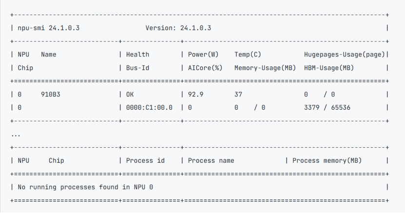
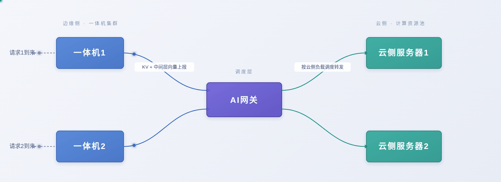

# DeepSeek V4-Flash

## 1 简介

DeepSeek-V4 在 DeepSeek-V3 的基础上引入了多项关键升级：

- 流形约束超连接（mHC），用于增强传统的残差连接。

- 一种混合注意力架构，通过 Compress-4-Attention 和 Compress-128-Attention 大幅提升长上下文效率。对于混合专家（MoE）组件，仍采用 DeepSeekMoE 架构，仅做了少量调整。

DeepSeek-V4-Flash 是 DeepSeek-V4 系列的轻量级变体，适用于高吞吐量和低延迟的服务场景。

本文档将演示模型的边云协同特性的部署方式。

## 2 前提条件

### 2.1 模型权重

DeepSeek-V4-Flash-w8a8-mtp（量化版本）：需要1个Atlas 800 A2（64GB × 8）节点，[下载模型权重](https://www.modelscope.cn/models/Eco-Tech/DeepSeek-V4-Flash-w8a8-mtp)。

### 2.2 节点通信

部署边云特性环境，需要按照[安装指南](../install.md)中的***节点通信验证***章节验证多节点通信。

### 2.3 一体机配置
在使用一体机作为边侧设备时，需要以下配置：

(1) 在物理机上插入ko(仅一体机场景)
```
insmod /usr/lib/modules/$(uname -r)$/updates/npu_peermem.ko
```
(2) 准备white_list白名单（一体机和云侧服务器都需要）

创建white_list.json文件，在其中写入部署推理服务所需服务器的业务面ip。
```commandline
{
    "host_ip":[
        "x.x.x.x",
        "y.y.y.y"
    ]
}
```
(3) 准备ranktable（一体机和云侧服务器都需要）

参考以下创建文件，写入一体机host网卡和服务器的npu网卡信息。
```commandline
{
    "status":"completed",   // ranktable可用标识，completed为可用
    "version":"1.0"         // ranktable模板版本信息,当前必须为"1.0"
    "server_count":"2",  //参与推理的AI Server数目，此例中，只有两个AI Server
    "server_list":[              
        {      //以下为rank信息，一体机在前，服务器在后
            "server_id":"10.0.0.10",   //AI Server标识,即业务面网卡ip
            "container_ip":"10.0.0.10",
            "host_ip":"10.0.0.10",
            "para_net_position":"host",   //类型一体机参数面使用host网卡，为"host"; 服务器使用npu网卡，为"device"
            "para_net_protocol":"rdma",   //  统一使用rdma 
            "device":[
                {
                    "rank_id":"0",      //文件中从0开始计数
                    "device_id":"1",    // npu-smi info 查询出的npu卡id
                    "device_ip":"192.168.1.1",  // 一体机参数面host网卡ip
                    "device_port":"16666",
                    "host_port":60002
                }
            ]
        },
        {
            "server_id":"11.0.0.10",  
            "container_ip":"11.0.0.10",
            "host_ip":"11.0.0.10",
            "para_net_position":"device",
            "para_net_protocol":"rdma", 
            "device":[
                {
                    "rank_id":"1", 
                    "device_id":"0",
                    "device_ip":"192.168.2.2",  //npu网卡地址
                    "device_port":"16666",
                    "host_port":60002
                },
                {
                    "rank_id":"2", 
                    "device_id":"1",
                    "device_ip":"192.168.2.3",
                    "device_port":"16666",
                    "host_port":60002
                },
                {
                    "rank_id":"3", 
                    "device_id":"2",
                    "device_ip":"192.168.2.4",
                    "device_port":"16666",
                    "host_port":60002
                },
                {
                    "rank_id":"4", 
                    "device_id":"3",
                    "device_ip":"192.168.2.5",
                    "device_port":"16666",
                    "host_port":60002
                },
                {
                    "rank_id":"5", 
                    "device_id":"4",
                    "device_ip":"192.168.2.6",
                    "device_port":"16666",
                    "host_port":60002
                },
                {
                    "rank_id":"6", 
                    "device_id":"5",
                    "device_ip":"192.168.2.7",
                    "device_port":"16666",
                    "host_port":60002
                },
                {
                    "rank_id":"7", 
                    "device_id":"6",
                    "device_ip":"192.168.2.8",
                    "device_port":"16666",
                    "host_port":60002
                },
                {
                    "rank_id":"8", 
                    "device_id":"7",
                    "device_ip":"192.168.2.9",
                    "device_port":"16666",
                    "host_port":60002
                }
            ]   
        }
    ]
}
```

## 3 环境安装

我们提供了[编译后版本的镜像](https://quay.io/repository/kyoshiki/vllm-ascend-v23.0rc1),使用该镜像进行环境准备。

### 3.1 容器创建
参考以下命令创建容器。
```commandline
export IMAGE=quay.io/ascend/vllm-ascend:v0.23.0.rc1 #按情况修改
docker run -itd --privileged \
--name=<container-name> \
--ipc=host --net=host\
--shm-size 500g \
--device=/dev/davinci0 \
--device=/dev/davinci1 \
--device=/dev/davinci2 \
--device=/dev/davinci3 \
--device=/dev/davinci4 \
--device=/dev/davinci5 \
--device=/dev/davinci6 \
--device=/dev/davinci7 \
--device=/dev/davinci_manager \
--device=/dev/hisi_hdc \
--device /dev/devmm_svm \
-v /usr/local/Ascend/driver:/usr/local/Ascend/driver \
-v /usr/local/Ascend/firmware:/usr/local/Ascend/firmware \
-v /usr/local/sbin/npu‑smi:/usr/local/sbin/npu‑smi \
-v /usr/local/sbin:/usr/local/sbin \
-v /etc/hccn.conf:/etc/hccn.conf \
-v /home/weight:/home/weight \
-it $IMAGE bash
```

表 3.1 参数说明

| 参数                                                 | 参数说明                                                                                                                                                                                                                                                                                                                                   |
|------------------------------------------------------|--------------------------------------------------------------------------------------------------------------------------------------------------------------------------------------------------------------------------------------------------------------------------------------------------------------------------------------------|
| --name                                               | 设置容器名称。                                                                                                                                                                                                                                                                                                                             |
| --device                                             | 表示映射的设备，可以挂载一个或者多个设备。需要挂载的设备如下：/dev/davinciX：NPU 设备，X 是 ID 号，如：davinci0。/dev/davinci_manager：davinci 相关的管理设备。/dev/hisi_hdc：hdc 相关管理设备。/dev/devmm_svm：内存管理相关设备。可根据以下命令查询 device 个数及名称方式，根据需要绑定设备，修改上面命令中的 "--device=****"。`ll /dev/` |
| -v /usr/local/Ascend/driver:/usr/local/Ascend/driver | 将宿主机目录 “/usr/local/Ascend/driver” 挂载到容器，请根据驱动所在实际路径修改。                                                                                                                                                                                                                                                           |
| -v /path‑to‑weights:/path‑to‑weights                 | 设定权重挂载的路径，需要根据用户的情况修改。请将权重文件和数据集文件同时放置于该路径下。                                                                                                                                                                                                                                                   |

### 3.2 执行以下命令进入容器。

```commandline
docker exec -it <container-name> bash
```

### 3.3 进入一体机容器,在容器内安装roce驱动(仅一体机场景)
找到SP681网卡驱动中的roce驱动，执行以下命令安装。
```commandline
dpkg hiroce3-*.deb
```

## 4 服务部署

(1) 边侧一体机
```bash
#!/usr/bin/bash
export VLLM_HOST_IP=<边侧业务面IP>
export GLOO_SOCKET_IFNAME=<边侧业务面网卡名>
export TP_SOCKET_IFNAME=<边侧业务面网卡名>
export HCCL_SOCKET_IFNAME=<边侧业务面网卡名>
export MASTER_ADDR=<边侧业务面IP>

export PYTORCH_NPU_ALLOC_CONF="expandable_segments:True"
export HCCL_OP_EXPANSION_MODE="AIV"
export LD_PRELOAD=/usr/lib/aarch64-linux-gnu/libjemalloc.so.2:$LD_PRELOAD
export OMP_PROC_BIND=false
export OMP_NUM_THREADS=10
export PYTORCH_NPU_ALLOC_CONF=expandable_segments:True
export ACL_OP_INIT_MODE=1
export VLLM_ASCEND_ENABLE_FLASHCOMM1=0
export USE_MULTI_GROUPS_KV_CACHE=1
export TASK_QUEUE_ENABLE=1
export HCCL_OP_EXPANSION_MODE="AIV"
export HCCL_BUFFSIZE=1024
export USE_MULTI_BLOCK_POOL=1
sysctl -w vm.swappiness=0
sysctl -w kernel.numa_balancing=0
sysctl kernel.sched_migration_cost_ns=50000
export TORCH_DISTRIBUTED_DETAIL=ERROR
export VLLM_LOGGING_LEVEL=ERROR

export ASCEND_RT_VISIBLE_DEVICES=0
export VLLM_ASCEND_LWD_PRE_OUT_PORT=7853
export VLLM_ASCEND_LWD_POST_OUT_PORT=7854

#一体机配置
export HCCL_WHITELIST_DISABLE="0"
export HCCL_WHITELIST_FILE="<白名单文件路径>"
export RANK_TABLE_FILE='<rank_table文件路径>'
export HCCL_IF_BASE_PORT=<HCCL_IF_BASE_PORT>

vllm serve <model_path> \
  --host 0.0.0.0 \
  --port 8088 \
  --master-addr <边侧业务面IP> \
  --master-port 29508 \
  --safetensors-load-strategy 'prefetch' \
  --max-model-len 135168 \
  --max-num-batched-tokens 20480 \
  --served-model-name <自定义模型名称> \
  --gpu-memory-utilization 0.92 \
  --max-num-seqs 128 \
  --trust-remote-code --nnodes 2 --node-rank 0 --edge-npu-count 1 --cloud-npu-count 8 \
  --enable-expert-parallel \
  --quantization ascend \
  --block-size 128 \
  --enable-chunked-prefill \
  --no-enable-prefix-caching \
  --tokenizer-mode deepseek_v4 \
  --tool-call-parser deepseek_v4 \
  --enable-auto-tool-choice \
  --reasoning-parser deepseek_v4 \
  --async-scheduling \
  --additional-config '{"enable_cpu_binding":true, "multistream_overlap_shared_expert":false, "enable_weight_nz_layout":true, "lwd_config":{"enabled":true,"role":"edge","mode":"prefill_only","edge_head_tail_layers":[0,0]}}' \
  --compilation-config '{"cudagraph_mode":"NONE","cudagraph_capture_sizes":[2,4,6,8,10,12,14,16,18,20,22,24,32,36,40]}' \
```
(2) 云侧服务器
```bash
#!/usr/bin/bash
export VLLM_HOST_IP=<云侧业务面IP>
export GLOO_SOCKET_IFNAME=<云侧业务面网卡名>
export TP_SOCKET_IFNAME=<云侧业务面网卡名>
export HCCL_SOCKET_IFNAME=<云侧业务面网卡名>

export LD_PRELOAD=/usr/lib/aarch64-linux-gnu/libjemalloc.so.2:$LD_PRELOAD
export OMP_PROC_BIND=false
export OMP_NUM_THREADS=10
export PYTORCH_NPU_ALLOC_CONF=expandable_segments:True
export ACL_OP_INIT_MODE=1
export VLLM_ASCEND_ENABLE_FLASHCOMM1=1
export USE_MULTI_GROUPS_KV_CACHE=1
export TASK_QUEUE_ENABLE=1
export HCCL_OP_EXPANSION_MODE="AIV"
export HCCL_BUFFSIZE=1024
export USE_MULTI_BLOCK_POOL=1
sysctl -w vm.swappiness=0
sysctl -w kernel.numa_balancing=0
sysctl kernel.sched_migration_cost_ns=50000
export TORCH_DISTRIBUTED_DETAIL=ERROR
export VLLM_LOGGING_LEVEL=ERROR

export ASCEND_RT_VISIBLE_DEVICES=0,1,2,3,4,5,6,7
export VLLM_ASCEND_LWD_PRE_OUT_PORT=7853
export VLLM_ASCEND_LWD_POST_OUT_PORT=7854
export VLLM_ASCEND_LWD_PRE_OUT_HOST=<云侧业务面IP>

#一体机配置
export HCCL_WHITELIST_DISABLE="0"
export HCCL_WHITELIST_FILE="<白名单文件路径>"
export RANK_TABLE_FILE='<rank_table文件路径>'

vllm serve <model_path> \
    --safetensors-load-strategy 'prefetch' \
    --master-addr <边侧业务面IP> \
    --master-port 29508\
    --max-model-len 136096 \
    --max-num-batched-tokens 20480 \
     -pp 2 \
    --served-model-name <自定义模型名称> \
    --gpu-memory-utilization 0.92 \
    --max-num-seqs 128 \
    --tensor-parallel-size 8 \
    --quantization ascend \
    --block-size 128 \
    --enable-expert-parallel \
    --enable-chunked-prefill \
    --no-enable-prefix-caching \
    --tokenizer-mode deepseek_v4 \
    --tool-call-parser deepseek_v4 \
    --trust-remote-code --nnodes 2 --node-rank 1 --edge-npu-count 1 --cloud-npu-count 8 \
    --enable-auto-tool-choice \
    --reasoning-parser deepseek_v4 \
    --speculative-config '{"num_speculative_tokens": 1, "method":"mtp"}' \
    --compilation-config '{"cudagraph_mode":"FULL_DECODE_ONLY","cudagraph_capture_sizes":[2, 4, 6, 8, 10, 12, 14, 16, 18, 20, 22, 24, 26, 28, 30, 32, 34, 36, 38, 40, 42, 44, 46, 48, 50, 52, 54, 56, 58, 60, 62, 64, 66, 68, 70, 72, 74, 76, 78, 80, 82, 84, 86, 88, 90, 92, 94, 96, 98, 100, 102, 104, 106, 108, 110, 112, 114, 116, 118, 120, 122, 124, 126, 128, 130, 132, 134, 136, 138, 140, 142, 144, 146, 148, 150, 152, 154, 156, 158, 160, 162, 164, 166, 168, 170, 172, 174, 176, 178, 180, 182, 184, 186, 188, 190, 192, 194, 196, 198, 200, 202, 204, 206, 208, 210, 212, 214, 216, 218, 220, 222, 224, 226, 228, 230, 232, 234, 236, 238, 240, 242, 244, 246, 248, 250, 252, 254, 256]}' \
    --async-scheduling \
    --additional-config '{"enable_cpu_binding":true, "ascend_compilation_config":{"enable_npugraph_ex":false,"enable_static_kernel":false},"multistream_overlap_shared_expert":false,"multistream_dsa_preprocess":false, "enable_weight_nz_layout":true, "lwd_config":{"enabled":true,"role":"cloud","mode":"prefill_only","edge_head_tail_layers":[0,0]}}' \
```
表4.1.1 关键配置参数说明


| 配置项                    | 配置说明                                                                                                                 |
|---------------------------|--------------------------------------------------------------------------------------------------------------------------|
| ASCEND_RT_VISIBLE_DEVICES | 表示启用哪几张卡。对于每个模型实例分配的 npuIds，使用芯片逻辑 ID 表示。                                                  |
| HCCL_WHITELIST_FILE       | 白名单文件路径，存放各服务器的业务面地址。                                                                               |
| RANK_TABLE_FILE           | ranktable的json格式文件路径，存放各服务器的业务面和参数面信息。                                                          |
| HCCL_IF_BASE_PORT         | 一体机hccl通信端口，需要根据使用npu卡的物理id（下图中最左侧的NPU号）进行修改。从1号卡开始为16657，卡号每加1，端口号减1。 |
| --served‑model‑name       | 模型名称。                                                                                                               |
| --host                    | 模型服务 IP，0.0.0.0 表示不指定 IP 地址，该服务器的 IP 皆可访问。                                                        |
| --port                    | 模型服务端口号。                                                                                                         |
| --max‑model‑len           | 模型服务上下文长度。                                                                                                     |



### 4.2 多实例
因为边云特性在边侧占用很少算力，所以可在边侧部署多个容器，创建多个服务和不同云侧服务器算卡对接，以下以一体机作为边侧算力，云侧使用不同服务器为例部署两实例：

(1) 边侧一体机容器1
```commandline
#!/usr/bin/bash
export VLLM_HOST_IP=<边侧业务面IP>
export GLOO_SOCKET_IFNAME=<边侧业务面网卡>
export TP_SOCKET_IFNAME=<边侧业务面网卡>
export HCCL_SOCKET_IFNAME=<边侧业务面网卡>
export MASTER_ADDR=<边侧业务面IP>

export PYTORCH_NPU_ALLOC_CONF="expandable_segments:True"
export HCCL_OP_EXPANSION_MODE="AIV"
export LD_PRELOAD=/usr/lib/aarch64-linux-gnu/libjemalloc.so.2:$LD_PRELOAD
export OMP_PROC_BIND=false
export OMP_NUM_THREADS=10
export PYTORCH_NPU_ALLOC_CONF=expandable_segments:True
export ACL_OP_INIT_MODE=1
export VLLM_ASCEND_ENABLE_FLASHCOMM1=0
export USE_MULTI_GROUPS_KV_CACHE=1
export TASK_QUEUE_ENABLE=1
export HCCL_OP_EXPANSION_MODE="AIV"
export HCCL_BUFFSIZE=1024
export USE_MULTI_BLOCK_POOL=1
export VLLM_ENGINE_READY_TIMEOUT_S=3600
sysctl -w vm.swappiness=0
sysctl -w kernel.numa_balancing=0
sysctl kernel.sched_migration_cost_ns=50000
export VLLM_ASCEND_LWD_HELLO_TIMEOUT_S=4800
export TORCH_DISTRIBUTED_DETAIL=ERROR
export VLLM_LOGGING_LEVEL=ERROR

export ASCEND_RT_VISIBLE_DEVICES=0
export VLLM_ASCEND_LWD_PRE_OUT_PORT=6853
export VLLM_ASCEND_LWD_POST_OUT_PORT=6854
export HCCL_NPU_SOCKET_PORT_RANGE=18710-18730

#一体机配置
export HCCL_WHITELIST_DISABLE="0"
export HCCL_WHITELIST_FILE="<白名单文件路径>"
export RANK_TABLE_FILE="<rank_table文件路径>"
export HCCL_IF_BASE_PORT=<HCCL_IF_BASE_PORT>

vllm serve <model_path> \
  --host 0.0.0.0 \
  --port 8088 \
  --master-addr <边侧业务面IP> \
  --api-server-count 2 \
  --api-server-rpc-port  23657 \
  --master-port 33657 \
  --pipeline-parallel-size 1 \
  --safetensors-load-strategy 'prefetch' \
  --max-model-len 300000 \
  --max-num-batched-tokens 12800 \
  --served-model-name <自定义模型名称> \
  --gpu-memory-utilization 0.94 \
  --max-num-seqs 128 \
  --trust-remote-code --nnodes 2 --node-rank 0 --edge-npu-count 1 --cloud-npu-count 16  --instance_parallel_size 2 --instance_parallel_start_rank 0 \
  --enable-expert-parallel \
  --quantization ascend \
  --block-size 128 \
  --enable-chunked-prefill \
  --no-enable-prefix-caching \
  --tokenizer-mode deepseek_v4 \
  --tool-call-parser deepseek_v4 \
  --enable-auto-tool-choice \
  --reasoning-parser deepseek_v4 \
  --async-scheduling \
  --additional-config '{"enable_cpu_binding":true, "multistream_overlap_shared_expert":false, "enable_weight_nz_layout":true, "lwd_config":{"enabled":true,"role":"edge","mode":"prefill_only","edge_head_tail_layers":[0,0]}}' \
  --compilation-config '{"cudagraph_mode":"NONE","cudagraph_capture_sizes":[2,4,6,8,10,12,14,16,18,20,22,24,32,36,40]}' \
```
(2) 边侧一体机容器2
```commandline
#!/usr/bin/bash
export VLLM_HOST_IP=<边侧业务面IP>
export GLOO_SOCKET_IFNAME=<边侧业务面网卡>
export TP_SOCKET_IFNAME=<边侧业务面网卡>
export HCCL_SOCKET_IFNAME=<边侧业务面网卡>
export MASTER_ADDR=<边侧业务面IP>

export PYTORCH_NPU_ALLOC_CONF="expandable_segments:True"
export HCCL_OP_EXPANSION_MODE="AIV"
export LD_PRELOAD=/usr/lib/aarch64-linux-gnu/libjemalloc.so.2:$LD_PRELOAD
export OMP_PROC_BIND=false
export OMP_NUM_THREADS=10
export PYTORCH_NPU_ALLOC_CONF=expandable_segments:True
export ACL_OP_INIT_MODE=1
export VLLM_ASCEND_ENABLE_FLASHCOMM1=0
export USE_MULTI_GROUPS_KV_CACHE=1
export TASK_QUEUE_ENABLE=1
export HCCL_OP_EXPANSION_MODE="AIV"
export HCCL_BUFFSIZE=1024
export USE_MULTI_BLOCK_POOL=1
export VLLM_ENGINE_READY_TIMEOUT_S=3600
sysctl -w vm.swappiness=0
sysctl -w kernel.numa_balancing=0
sysctl kernel.sched_migration_cost_ns=50000
export VLLM_ASCEND_LWD_HELLO_TIMEOUT_S=4800
export TORCH_DISTRIBUTED_DETAIL=ERROR
export VLLM_LOGGING_LEVEL=ERROR

export ASCEND_RT_VISIBLE_DEVICES=0
export VLLM_ASCEND_LWD_PRE_OUT_PORT=6853
export VLLM_ASCEND_LWD_POST_OUT_PORT=6854
export HCCL_NPU_SOCKET_PORT_RANGE=18710-18730

#一体机配置
export HCCL_WHITELIST_DISABLE="0"
export HCCL_WHITELIST_FILE="<白名单文件路径>"
export RANK_TABLE_FILE="<rank_table文件路径>"
export HCCL_IF_BASE_PORT=<HCCL_IF_BASE_PORT>

vllm serve <model_path> \
  --host 0.0.0.0 \
  --port 8089 \
  --master-addr <边侧业务面IP> \
  --api-server-count 2 \
  --api-server-attach  <边侧业务面IP>:23657 \
  --master-port 33657 \
  --pipeline-parallel-size 1 \
  --safetensors-load-strategy 'prefetch' \
  --max-model-len 300000 \
  --max-num-batched-tokens 12800 \
  --served-model-name <自定义模型名称> \
  --gpu-memory-utilization 0.94 \
  --max-num-seqs 128 \
  --trust-remote-code --nnodes 2 --node-rank 0 --edge-npu-count 1 --cloud-npu-count 16  --instance_parallel_size 2 --instance_parallel_start_rank 1 \
  --enable-expert-parallel \
  --quantization ascend \
  --block-size 128 \
  --enable-chunked-prefill \
  --no-enable-prefix-caching \
  --tokenizer-mode deepseek_v4 \
  --tool-call-parser deepseek_v4 \
  --enable-auto-tool-choice \
  --reasoning-parser deepseek_v4 \
  --async-scheduling \
  --additional-config '{"enable_cpu_binding":true, "multistream_overlap_shared_expert":false, "enable_weight_nz_layout":true, "lwd_config":{"enabled":true,"role":"edge","mode":"prefill_only","edge_head_tail_layers":[0,0]}}' \
  --compilation-config '{"cudagraph_mode":"NONE","cudagraph_capture_sizes":[2,4,6,8,10,12,14,16,18,20,22,24,32,36,40]}' \
```
(3) 云侧服务器1
```commandline
#!/usr/bin/bash
export VLLM_HOST_IP=<云1业务面IP>
export GLOO_SOCKET_IFNAME=<云1业务面网卡>
export TP_SOCKET_IFNAME=<云1业务面网卡>
export HCCL_SOCKET_IFNAME=<云1业务面网卡>

export LD_PRELOAD=/usr/lib/aarch64-linux-gnu/libjemalloc.so.2:$LD_PRELOAD
export OMP_PROC_BIND=false
export OMP_NUM_THREADS=10
export PYTORCH_NPU_ALLOC_CONF=expandable_segments:True
export ACL_OP_INIT_MODE=1
export VLLM_ASCEND_ENABLE_FLASHCOMM1=1
export USE_MULTI_GROUPS_KV_CACHE=1
export TASK_QUEUE_ENABLE=1
export HCCL_OP_EXPANSION_MODE="AIV"
export HCCL_BUFFSIZE=1024
export USE_MULTI_BLOCK_POOL=1
sysctl -w vm.swappiness=0
sysctl -w kernel.numa_balancing=0
sysctl kernel.sched_migration_cost_ns=50000
export TORCH_DISTRIBUTED_DETAIL=ERROR
export VLLM_LOGGING_LEVEL=ERROR
export VLLM_ASCEND_LWD_HELLO_TIMEOUT_S=4800
export VLLM_ENGINE_READY_TIMEOUT_S=3600

export ASCEND_RT_VISIBLE_DEVICES=0,1,2,3,4,5,6,7
export VLLM_ASCEND_LWD_PRE_OUT_PORT=6853
export VLLM_ASCEND_LWD_POST_OUT_PORT=6854
export VLLM_ASCEND_LWD_PRE_OUT_HOST=<云1业务面IP>
export HCCL_NPU_SOCKET_PORT_RANGE=18710-18730

#一体机配置
export HCCL_WHITELIST_DISABLE="0"
export HCCL_WHITELIST_FILE="<白名单文件路径>"
export RANK_TABLE_FILE="<rank_table文件路径>"

vllm serve <model_path> \
    --safetensors-load-strategy 'prefetch' \
    --master-addr <边侧业务面IP> \
    --master-port 33657\
    --max-model-len 300000 \
    --max-num-batched-tokens 12800 \
    -pp 2 \
    --served-model-name <自定义模型名称> \
    --gpu-memory-utilization 0.94 \
    --max-num-seqs 128 \
    --tensor-parallel-size 8 \
    --quantization ascend \
    --block-size 128 \
    --enable-expert-parallel \
    --enable-chunked-prefill \
    --no-enable-prefix-caching \
    --tokenizer-mode deepseek_v4 \
    --tool-call-parser deepseek_v4 \
    --trust-remote-code --nnodes 2 --node-rank 1  --edge-npu-count 1 --cloud-npu-count 16 --instance_parallel_size 2 --instance_parallel_start_rank 0 \
    --enable-auto-tool-choice \
    --reasoning-parser deepseek_v4 \
    --speculative-config '{"num_speculative_tokens": 1, "method":"mtp"}' \
    --compilation-config '{"cudagraph_mode":"FULL_DECODE_ONLY", "cudagraph_capture_sizes":[2, 4, 6, 8, 10, 12, 14, 16, 18, 20, 22, 24, 26, 28, 30, 32, 34, 36, 38, 40, 42, 44, 46, 48, 50, 52, 54, 56, 58, 60, 62, 64, 66, 68, 70, 72, 74, 76, 78, 80, 82, 84, 86, 88, 90, 92, 94, 96, 98, 100, 102, 104, 106, 108, 110, 112, 114, 116, 118, 120, 122, 124, 126, 128, 130, 132, 134, 136, 138, 140, 142, 144, 146, 148, 150, 152, 154, 156, 158, 160, 162, 164, 166, 168, 170, 172, 174, 176, 178, 180, 182, 184, 186, 188, 190, 192, 194, 196, 198, 200, 202, 204, 206, 208, 210, 212, 214, 216, 218, 220, 222, 224, 226, 228, 230, 232, 234, 236, 238, 240, 242, 244, 246, 248, 250, 252, 254, 256]}' \
    --async-scheduling \
    --additional-config '{"enable_cpu_binding":true, "ascend_compilation_config":{"enable_npugraph_ex":false,"enable_static_kernel":false},"multistream_overlap_shared_expert":false,"multistream_dsa_preprocess":false, "enable_weight_nz_layout":true, "lwd_config":{"enabled":true,"role":"cloud","mode":"prefill_only","edge_head_tail_layers":[0,0]}}' \
```
(4) 云侧服务器2
```commandline
#!/usr/bin/bash
export VLLM_HOST_IP=<云2业务面IP>
export GLOO_SOCKET_IFNAME=<云2业务面网卡>
export TP_SOCKET_IFNAME=<云2业务面网卡>
export HCCL_SOCKET_IFNAME=<云2业务面网卡>

export LD_PRELOAD=/usr/lib/aarch64-linux-gnu/libjemalloc.so.2:$LD_PRELOAD
export OMP_PROC_BIND=false
export OMP_NUM_THREADS=10
export PYTORCH_NPU_ALLOC_CONF=expandable_segments:True
export ACL_OP_INIT_MODE=1
export VLLM_ASCEND_ENABLE_FLASHCOMM1=1
export USE_MULTI_GROUPS_KV_CACHE=1
export TASK_QUEUE_ENABLE=1
export HCCL_OP_EXPANSION_MODE="AIV"
export HCCL_BUFFSIZE=1024
export USE_MULTI_BLOCK_POOL=1
sysctl -w vm.swappiness=0
sysctl -w kernel.numa_balancing=0
sysctl kernel.sched_migration_cost_ns=50000
export TORCH_DISTRIBUTED_DETAIL=ERROR
export VLLM_LOGGING_LEVEL=ERROR
export VLLM_ASCEND_LWD_HELLO_TIMEOUT_S=4800
export VLLM_ENGINE_READY_TIMEOUT_S=3600

export ASCEND_RT_VISIBLE_DEVICES=0,1,2,3,4,5,6,7
export VLLM_ASCEND_LWD_PRE_OUT_PORT=6853
export VLLM_ASCEND_LWD_POST_OUT_PORT=6854
export VLLM_ASCEND_LWD_PRE_OUT_HOST=<云2业务面IP>
export HCCL_NPU_SOCKET_PORT_RANGE=18710-18730

#一体机配置
export HCCL_WHITELIST_DISABLE="0"
export HCCL_WHITELIST_FILE="<白名单文件路径>"
export RANK_TABLE_FILE="<rank_table文件路径>"

vllm serve <model_path> \
    --safetensors-load-strategy 'prefetch' \
    --master-addr <边侧业务面IP> \
    --master-port 33657 \
    --max-model-len 300000 \
    --max-num-batched-tokens 12800 \
     -pp 2 \
    --served-model-name <自定义模型名称> \
    --gpu-memory-utilization 0.94 \
    --max-num-seqs 128 \
    --tensor-parallel-size 8 \
    --quantization ascend \
    --block-size 128 \
    --enable-expert-parallel \
    --enable-chunked-prefill \
    --no-enable-prefix-caching \
    --tokenizer-mode deepseek_v4 \
    --tool-call-parser deepseek_v4 \
    --trust-remote-code --nnodes 2 --node-rank 1  --edge-npu-count 1 --cloud-npu-count 16 --instance_parallel_size 2 --instance_parallel_start_rank 1 \
    --enable-auto-tool-choice \
    --reasoning-parser deepseek_v4 \
    --speculative-config '{"num_speculative_tokens": 1, "method":"mtp"}' \
    --compilation-config '{"cudagraph_mode":"FULL_DECODE_ONLY", "cudagraph_capture_sizes":[2, 4, 6, 8, 10, 12, 14, 16, 18, 20, 22, 24, 26, 28, 30, 32, 34, 36, 38, 40, 42, 44, 46, 48, 50, 52, 54, 56, 58, 60, 62, 64, 66, 68, 70, 72, 74, 76, 78, 80, 82, 84, 86, 88, 90, 92, 94, 96, 98, 100, 102, 104, 106, 108, 110, 112, 114, 116, 118, 120, 122, 124, 126, 128, 130, 132, 134, 136, 138, 140, 142, 144, 146, 148, 150, 152, 154, 156, 158, 160, 162, 164, 166, 168, 170, 172, 174, 176, 178, 180, 182, 184, 186, 188, 190, 192, 194, 196, 198, 200, 202, 204, 206, 208, 210, 212, 214, 216, 218, 220, 222, 224, 226, 228, 230, 232, 234, 236, 238, 240, 242, 244, 246, 248, 250, 252, 254, 256]}' \
    --async-scheduling \
    --additional-config '{"enable_cpu_binding":true, "ascend_compilation_config":{"enable_npugraph_ex":false,"enable_static_kernel":false},"multistream_overlap_shared_expert":false,"multistream_dsa_preprocess":false, "enable_weight_nz_layout":true, "lwd_config":{"enabled":true,"role":"cloud","mode":"prefill_only","edge_head_tail_layers":[0,0]}}' \
```
表4.2.1 关键配置参数说明

| 配置项                    | 配置说明                                                                                          |
|---------------------------|---------------------------------------------------------------------------------------------------|
| ASCEND_RT_VISIBLE_DEVICES | 表示启用哪几张卡。对于每个模型实例分配的 npuIds，使用芯片逻辑 ID 表示。                           |
| HCCL_WHITELIST_FILE       | 白名单文件路径，存放各服务器的业务面地址。                                                        |
| RANK_TABLE_FILE           | ranktable的json格式文件路径，存放各服务器的业务面和参数面信息。                                   |
| HCCL_IF_BASE_PORT         | 一体机hccl通信端口，需要根据使用npu卡的物理id进行修改。从1号卡开始为16657，卡号每加1，端口号减1。 |
| --served‑model‑name       | 模型名称。                                                                                        |
| --host                    | 模型服务 IP，0.0.0.0 表示不指定 IP 地址，该服务器的 IP 皆可访问。                                 |
| --port                    | 模型服务端口号。                                                                                  |
| --max‑model‑len           | 模型服务上下文长度。                                                                              |
| --api-server-count        | 边侧实例数。                                                                                      |
| --api-server-rpc-port     | 实例0和其他实例通信端口。                                                                         |
| --api-server-attach       | 非实例0和实例0通信ip和端口。                                                                      |

### 4.3 云侧复用

部署模型时云侧设备算例如果有空闲，可云侧复用部署多个服务，具体流程如下图所示。服务器到达边侧后，由一体机进行处理生成kv和中间层向量，后转发到AI网关，由AI网关根据云侧服务器负载情况转发到合适的云侧服务器进行处理。在无AI网关情况下，可在边侧配置直接转发到云侧服务器。



以下以多个一体机服务作为边侧算力，云侧使用一台服务器为例部署：
(1) 创建边云全局共享的静态角色注册表，规定边云的拓扑结构（yaml格式文件）
```commandline
world:
    master_addr:<node0 IP,复用边1业务面IP>
    master_port:<master_port>
edge:
    -id:0
    addr:<边1业务面IP>
    ranks:[0] #使用npu的卡号
    -id:1
    addr:<边2业务面IP>
    ranks:[0] #使用npu的卡号
clouds:
    -id:0
    addr:<云侧业务面IP>
    ranks:[0,1,2,3] #使用npu的卡号
    zmq_base_port:<port> #假设由n个边，需要占用[port,port+2*n]区间内的端口，确保这些端口无占用
```
(2) 创建租户密钥文件tenant_key_file隔离不同来源的kv
只在边侧持有，按照十六进制写入，二进制读取，需要≥16字节，例如`7a2f9d4c810e3b56290f74ac58bd32071ce694085f213bc709426da518c4963`。

(3) 服务部署

a. 边侧一体机1
```commandline
#!/usr/bin/bash
export VLLM_HOST_IP=<边1业务面IP>
export GLOO_SOCKET_IFNAME=<边1业务面网卡>
export TP_SOCKET_IFNAME=<边1业务面网卡>
export HCCL_SOCKET_IFNAME=<边1业务面网卡>
export MASTER_ADDR=<node0 IP>

export PYTORCH_NPU_ALLOC_CONF="expandable_segments:True"
export HCCL_OP_EXPANSION_MODE="AIV"
export LD_PRELOAD=/usr/lib/aarch64-linux-gnu/libjemalloc.so.2:$LD_PRELOAD
export OMP_PROC_BIND=false
export OMP_NUM_THREADS=10
export PYTORCH_NPU_ALLOC_CONF=expandable_segments:True
export ACL_OP_INIT_MODE=1
export VLLM_ASCEND_ENABLE_FLASHCOMM1=0
export USE_MULTI_GROUPS_KV_CACHE=1
export TASK_QUEUE_ENABLE=1
export HCCL_OP_EXPANSION_MODE="AIV"
export HCCL_BUFFSIZE=1024
export USE_MULTI_BLOCK_POOL=1
sysctl -w vm.swappiness=0
sysctl -w kernel.numa_balancing=0
sysctl kernel.sched_migration_cost_ns=50000
export TORCH_DISTRIBUTED_DETAIL=ERROR
export VLLM_LOGGING_LEVEL=ERROR

export ASCEND_RT_VISIBLE_DEVICES=0
export VLLM_ASCEND_LWD_PRE_OUT_PORT=7853
export VLLM_ASCEND_LWD_POST_OUT_PORT=7854

#一体机配置
export HCCL_WHITELIST_DISABLE="0"
export HCCL_WHITELIST_FILE="<白名单文件路径>"
export RANK_TABLE_FILE="<rank_table文件路径>"
export HCCL_IF_BASE_PORT=<HCCL_IF_BASE_PORT>

vllm serve <model_path> \
  --host 0.0.0.0 \
  --port 8094 \
  --master-addr <node0 IP> \
  --master-port 29508 \
  --edge-id 0 \
  --role-registry "<边云全局共享的静态角色注册表.yaml>" \
  --safetensors-load-strategy 'prefetch' \
  --max-model-len 135168 \
  --max-num-batched-tokens 20480 \
  --served-model-name <自定义模型名称> \
  --gpu-memory-utilization 0.9 \
  --max-num-seqs 128 \
  --trust-remote-code --nnodes 3 --node-rank 0 --edge-npu-count 1 --cloud-npu-count 8 \
  --enable-expert-parallel \
  --quantization ascend \
  --block-size 128 \
  --enable-chunked-prefill \
  --no-enable-prefix-caching \
  --tokenizer-mode deepseek_v4 \
  --tool-call-parser deepseek_v4 \
  --enable-auto-tool-choice \
  --reasoning-parser deepseek_v4 \
  --async-scheduling \
  --additional-config '{"enable_cpu_binding":true, "multistream_overlap_shared_expert":false, "enable_weight_nz_layout":true, "lwd_config":{"enabled":true,"role":"edge","mode":"prefill_only","edge_head_tail_layers":[0,0]}, "lwd_coordination": {"enabled": true, "control_url": "<控制url,此场景填写云侧服务监听地址>", "tenant_key_file": "<租户密钥文件>", "consumer_id": "enterprise-a-edge0", "connect_timeout":5.0}}' \
  --compilation-config '{"cudagraph_mode":"NONE","cudagraph_capture_sizes":[2,4,6,8,10,12,14,16,18,20,22,24,32,36,40]}' \
```
b. 边侧一体机2
```commandline
#!/usr/bin/bash
export VLLM_HOST_IP=<边2业务面IP>
export GLOO_SOCKET_IFNAME=<边2业务面网卡>
export TP_SOCKET_IFNAME=<边2业务面网卡>
export HCCL_SOCKET_IFNAME=<边2业务面网卡>
export MASTER_ADDR=<node0 IP>

export PYTORCH_NPU_ALLOC_CONF="expandable_segments:True"
export HCCL_OP_EXPANSION_MODE="AIV"
export LD_PRELOAD=/usr/lib/aarch64-linux-gnu/libjemalloc.so.2:$LD_PRELOAD
export OMP_PROC_BIND=false
export OMP_NUM_THREADS=10
export PYTORCH_NPU_ALLOC_CONF=expandable_segments:True
export ACL_OP_INIT_MODE=1
export VLLM_ASCEND_ENABLE_FLASHCOMM1=0
export USE_MULTI_GROUPS_KV_CACHE=1
export TASK_QUEUE_ENABLE=1
export HCCL_OP_EXPANSION_MODE="AIV"
export HCCL_BUFFSIZE=1024
export USE_MULTI_BLOCK_POOL=1
sysctl -w vm.swappiness=0
sysctl -w kernel.numa_balancing=0
sysctl kernel.sched_migration_cost_ns=50000
export TORCH_DISTRIBUTED_DETAIL=ERROR
export VLLM_LOGGING_LEVEL=ERROR

export ASCEND_RT_VISIBLE_DEVICES=1
export VLLM_ASCEND_LWD_PRE_OUT_PORT=7853
export VLLM_ASCEND_LWD_POST_OUT_PORT=7854

#一体机配置
export HCCL_WHITELIST_DISABLE="0"
export HCCL_WHITELIST_FILE="<白名单文件路径>"
export RANK_TABLE_FILE="<rank_table文件路径>"
export HCCL_IF_BASE_PORT=<HCCL_IF_BASE_PORT>

vllm serve <model_path> \
  --host 0.0.0.0 \
  --port 8095 \
  --master-addr <node0 IP> \
  --master-port 29508 \
  --edge-id 1 \
  --role-registry "<边云全局共享的静态角色注册表yaml>" \
  --safetensors-load-strategy 'prefetch' \
  --max-model-len 135168 \
  --max-num-batched-tokens 20480 \
  --served-model-name <自定义模型名称> \
  --gpu-memory-utilization 0.9 \
  --max-num-seqs 128 \
  --trust-remote-code --nnodes 3 --node-rank 1 --edge-npu-count 1 --cloud-npu-count 8 \
  --enable-expert-parallel \
  --quantization ascend \
  --block-size 128 \
  --enable-chunked-prefill \
  --no-enable-prefix-caching \
  --tokenizer-mode deepseek_v4 \
  --tool-call-parser deepseek_v4 \
  --enable-auto-tool-choice \
  --reasoning-parser deepseek_v4 \
  --async-scheduling \
    --additional-config '{"enable_cpu_binding":true, "multistream_overlap_shared_expert":false, "enable_weight_nz_layout":true, "lwd_config":{"enabled":true,"role":"edge","mode":"prefill_only","edge_head_tail_layers":[0,0]}, "lwd_coordination": {"enabled": true, "control_url": "<控制url,此场景填写云侧服务监听地址>", "tenant_key_file": "<租户密钥文件>", "consumer_id": "enterprise-a-edge1", "connect_timeout":5.0}}' \
  --compilation-config '{"cudagraph_mode":"NONE","cudagraph_capture_sizes":[2,4,6,8,10,12,14,16,18,20,22,24,32,36,40]}' \
```
c. 云侧服务器
```commandline
#!/usr/bin/bash
export VLLM_HOST_IP=<云侧业务面IP>
export GLOO_SOCKET_IFNAME=<云侧业务面IP>
export TP_SOCKET_IFNAME=<云侧业务面网卡>
export HCCL_SOCKET_IFNAME=<云侧业务面网卡>
export MASTER_ADDR=<node0 IP>

export LD_PRELOAD=/usr/lib/aarch64-linux-gnu/libjemalloc.so.2:$LD_PRELOAD
export OMP_PROC_BIND=false
export OMP_NUM_THREADS=10
export PYTORCH_NPU_ALLOC_CONF=expandable_segments:True
export ACL_OP_INIT_MODE=1
export VLLM_ASCEND_ENABLE_FLASHCOMM1=1
export USE_MULTI_GROUPS_KV_CACHE=1
export TASK_QUEUE_ENABLE=1
export HCCL_OP_EXPANSION_MODE="AIV"
export HCCL_BUFFSIZE=1024
export USE_MULTI_BLOCK_POOL=1
sysctl -w vm.swappiness=0
sysctl -w kernel.numa_balancing=0
sysctl kernel.sched_migration_cost_ns=50000
export TORCH_DISTRIBUTED_DETAIL=ERROR
export VLLM_LOGGING_LEVEL=ERROR

export ASCEND_RT_VISIBLE_DEVICES=0,1,2,3,4,5,6,7
export VLLM_ASCEND_LWD_PRE_OUT_PORT=7853
export VLLM_ASCEND_LWD_POST_OUT_PORT=7854
export VLLM_ASCEND_LWD_PRE_OUT_HOST=76.76.7.158

#一体机配置
export HCCL_WHITELIST_DISABLE="0"
export HCCL_WHITELIST_FILE="<白名单文件路径>"
export RANK_TABLE_FILE="<rank_table文件路径>"

vllm serve <model_path> \
    --safetensors-load-strategy 'prefetch' \
    --master-addr <node0 IP> \
    --master-port 29508\
    --max-model-len 136096 \
    --max-num-batched-tokens 20480 \
    --role-registry "<边云全局共享的静态角色注册表yaml>" \
    --cloud-id 0 \
     -pp 2 \
    --served-model-name <自定义模型名称> \
    --gpu-memory-utilization 0.9 \
    --max-num-seqs 128 \
    --tensor-parallel-size 8 \
    --quantization ascend \
    --block-size 128 \
    --enable-expert-parallel \
    --enable-chunked-prefill \
    --enable-prefix-caching \
    --tokenizer-mode deepseek_v4 \
    --tool-call-parser deepseek_v4 \
    --trust-remote-code --nnodes 3 --node-rank 2 --edge-npu-count 1 --cloud-npu-count 8 \
    --enable-auto-tool-choice \
    --reasoning-parser deepseek_v4 \
    --speculative-config '{"num_speculative_tokens": 1, "method":"mtp"}' \
    --compilation-config '{"cudagraph_mode":"FULL_DECODE_ONLY","cudagraph_capture_sizes":[2, 4, 6, 8, 10, 12, 14, 16, 18, 20, 22, 24, 26, 28, 30, 32, 34, 36, 38, 40, 42, 44, 46, 48, 50, 52, 54, 56, 58, 60, 62, 64, 66, 68, 70, 72, 74, 76, 78, 80, 82, 84, 86, 88, 90, 92, 94, 96, 98, 100, 102, 104, 106, 108, 110, 112, 114, 116, 118, 120, 122, 124, 126, 128, 130, 132, 134, 136, 138, 140, 142, 144, 146, 148, 150, 152, 154, 156, 158, 160, 162, 164, 166, 168, 170, 172, 174, 176, 178, 180, 182, 184, 186, 188, 190, 192, 194, 196, 198, 200]}' \
    --async-scheduling \
    --additional-config '{"enable_cpu_binding":true, "ascend_compilation_config":{"enable_npugraph_ex":false,"enable_static_kernel":false},"multistream_overlap_shared_expert":false,"multistream_dsa_preprocess":false, "enable_weight_nz_layout":true, "lwd_config":{"enabled":true,"role":"cloud","mode":"prefill_only","edge_head_tail_layers":[0,0]}, "lwd_coordination": {"enabled": true, "listen_host": "0.0.0.0", "listen_port": <port>, "instance_id": "cloud-0"}}' \
```
表 4.3.1 关键参数说明

| 配置项                    | 配置说明                                                                                                                          |
|---------------------------|-----------------------------------------------------------------------------------------------------------------------------------|
| ASCEND_RT_VISIBLE_DEVICES | 表示启用哪几张卡。对于每个模型实例分配的 npuIds，使用芯片逻辑 ID 表示。                                                           |
| HCCL_WHITELIST_FILE       | 白名单文件路径，存放各服务器的业务面地址。                                                                                        |
| RANK_TABLE_FILE           | ranktable的json格式文件路径，存放各服务器的业务面和参数面信息。                                                                   |
| HCCL_IF_BASE_PORT         | 一体机hccl通信端口，需要根据使用npu卡的物理id进行修改。从1号卡开始为16657，卡号每加1，端口号减1。                                 |
| --served‑model‑name       | 模型名称。                                                                                                                        |
| --host                    | 模型服务 IP，0.0.0.0 表示不指定 IP 地址，该服务器的 IP 皆可访问。                                                                 |
| --port                    | 模型服务端口号。                                                                                                                  |
| --max‑model‑len           | 模型服务上下文长度。                                                                                                              |
| --edge-id                 | 边侧设备的唯一id标识，从0开始。                                                                                                   |
| --role-registry           | 边云全局共享的yaml格式的静态角色注册表，规定边云的拓扑结构。                                                                      |
| control_url               | 控制url,需要网关调度填写网关地址，无网关地址则填写需要使用的云侧服务监听地址，例如：http://xx.xx.xx.xx:port/v1/chat/completions。 |
| listen_host/port          | 云侧协调HTTP服务监听地址，默认为0.0.0.0：8100，和边侧的control_url搭配使用。                                                      |
| tenant_key_file           | 租户密钥文件，用户多个服务间隔离，只在边侧持有。                                                                                  |
| consumer_id               | 边侧标识id,每个服务不一样，例如enterprise-a-edge0。                                                                               |
| instance_id               | 云侧标识id,每个服务不一样，例如cloud-0。                                                                                          |

## 5 功能验证
服务启动后，可通过发送提示词调用模型。支持两个API接口：completions和chat.completions。使用您配置的`--served-model-name`。

Completions API：
```commandline
curl http://localhost:8000/v1/completions \
    -H "Content-Type: application/json" \
    -d '{
        "model": "<自定义模型名称>",
        "prompt": "The future of AI is",
        "max_tokens": 50,
        "temperature": 0
    }'
```

Chat Completions API：
```commandline
curl http://localhost:8000/v1/chat/completions \
    -H "Content-Type: application/json" \
    -d '{
        "model": "<自定义模型名称>",
        "messages": [
            {"role": "user", "content": "The future of AI is"}
        ],
        "max_completion_tokens": 1024,
        "temperature": 0.7,
        "top_p": 0.95
    }'
```
预期结果：服务返回HTTP 200 OK。JSON响应包含choices字段及生成的文本。completions API的示例输出（内容已截断以保持简洁）：
```commandline
{
    "id": "cmpl-xxxxxxxxxxxxx",
    "object": "text_completion",
    "created": 1780971952,
    "model": "<自定义模型名称>",
    "choices": [
        {
            "index": 0,
            "text": "The future of AI is a rapidly evolving landscape with breakthroughs in natural language understanding, multimodal reasoning, and autonomous agents. As models grow more capable and efficient...",
            "logprobs": null,
            "finish_reason": "length"
        }
    ],
    "usage": {
        "prompt_tokens": 4,
        "total_tokens": 54,
        "completion_tokens": 50
    }
}
```