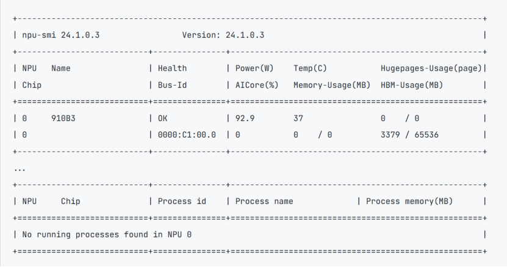

# GLM-5.1

## 1 简介

GLM-5 采用混合专家（MoE）架构，面向复杂系统工程和长周期智能体任务。

本文档将演示模型的边云协同特性的部署方式， 我们强烈建议使用`vllm-ascend:v0.23.0rc1`镜像进行部署。

## 2 前提条件

### 2.1 模型权重

GLM-5.1-w8a8（量化版本）：需要1个Atlas 800 A3（128GB × 8）节点。[下载模型权重](https://modelers.cn/models/Eco-Tech/GLM-5.1-w8a8)

### 2.2 节点通信

部署边云特性环境，需要按照[安装指南](../install.md)中的***节点通信验证***章节验证多节点通信。

### 2.3 一体机配置
在使用一体机作为边侧设备时，需要以下配置
1. 在物理机上插入ko(仅一体机场景)
```
insmod /usr/lib/modules/$(uname -r)$/updates/npu_peermem.ko
```
2. 准备white_list白名单（一体机和云测服务器都需要）

创建white_list.json文件，在其中写入部署推理服务所需服务器的业务面ip
```commandline
{
    "host_ip":[
        "x.x.x.x",
        "y.y.y.y"
    ]
}
```
3. 准备ranktable（一体机和云测服务器都需要）
```commandline
{
    "status":"completed",   // ranktable可用标识，completed为可用
    "version":"1.0"         // ranktable模板版本信息,当前必须为"1.0"
    "server_count":"2",  //参与推理的AI Server数目，此例中，只有两个AI Server
    "server_list":[              
        {      //以下为rank信息，一体机在前，服务器在后
            "server_id":"10.0.0.10",   //AI Server标识,即业务面网卡ip
            "container_ip":"10.0.0.10",
            "host_ip":"10.0.0.10",
            "para_net_position":"host",   //类型一体机参数面使用host网卡，为"host"; 服务器使用npu网卡，为"device"
            "para_net_protocol":"rdma",   //  统一使用rdma 
            "device":[
                {
                    "rank_id":"0",      //文件中从0开始计数
                    "device_id":"1",    // npu-smi info 查询出的npu卡id
                    "device_ip":"192.168.1.1",  // 一体机参数面host网卡ip
                    "device_port":"16666",
                    "host_port":60002
                }
            ]
        },
        {
            "server_id":"11.0.0.10",  
            "container_ip":"11.0.0.10",
            "host_ip":"11.0.0.10",
            "para_net_position":"device",
            "para_net_protocol":"rdma", 
            "device":[
                {
                    "rank_id":"1", 
                    "device_id":"0",
                    "device_ip":"192.168.2.2",  //npu网卡地址
                    "device_port":"16666",
                    "host_port":60002
                },
                {
                    "rank_id":"2", 
                    "device_id":"1",
                    "device_ip":"192.168.2.3",
                    "device_port":"16666",
                    "host_port":60002
                },
                {
                    "rank_id":"3", 
                    "device_id":"2",
                    "device_ip":"192.168.2.4",
                    "device_port":"16666",
                    "host_port":60002
                },
                {
                    "rank_id":"4", 
                    "device_id":"3",
                    "device_ip":"192.168.2.5",
                    "device_port":"16666",
                    "host_port":60002
                },
                {
                    "rank_id":"5", 
                    "device_id":"4",
                    "device_ip":"192.168.2.6",
                    "device_port":"16666",
                    "host_port":60002
                },
                {
                    "rank_id":"6", 
                    "device_id":"5",
                    "device_ip":"192.168.2.7",
                    "device_port":"16666",
                    "host_port":60002
                },
                {
                    "rank_id":"7", 
                    "device_id":"6",
                    "device_ip":"192.168.2.8",
                    "device_port":"16666",
                    "host_port":60002
                },
                {
                    "rank_id":"8", 
                    "device_id":"7",
                    "device_ip":"192.168.2.9",
                    "device_port":"16666",
                    "host_port":60002
                }
            ]   
        }
    ]
}
```

## 3 环境安装

我们推荐使用[vLLM-ascend镜像](https://quay.io/repository/ascend/vllm-ascend?tab=tags&tag=latest)创建容器，然后进行编译安装；此外我们也提供了[编译后版本的镜像](https://quay.io/user/kyoshiki/),使用该镜像的话可跳过3.3节。
### 3.1 容器创建
参考以下命令创建容器。
```commandline
export IMAGE=quay.io/ascend/vllm-ascend:v0.23.0.rc1 #可修改
docker run -itd --privileged \
--name=<container-name> \
--ipc=host --net=host\
--shm-size 500g \
--device=/dev/davinci0 \
--device=/dev/davinci1 \
--device=/dev/davinci2 \
--device=/dev/davinci3 \
--device=/dev/davinci4 \
--device=/dev/davinci5 \
--device=/dev/davinci6 \
--device=/dev/davinci7 \
--device=/dev/davinci_manager \
--device=/dev/hisi_hdc \
--device /dev/devmm_svm \
-v /usr/local/Ascend/driver:/usr/local/Ascend/driver \
-v /usr/local/Ascend/firmware:/usr/local/Ascend/firmware \
-v /usr/local/sbin/npu‑smi:/usr/local/sbin/npu‑smi \
-v /usr/local/sbin:/usr/local/sbin \
-v /etc/hccn.conf:/etc/hccn.conf \
-v /home/weight:/home/weight \
-it $IMAGE bash
```

表 1 参数说明

| 参数                                                 | 参数说明                                                                                                                                                                                                                                                                                                                                   |
|------------------------------------------------------|--------------------------------------------------------------------------------------------------------------------------------------------------------------------------------------------------------------------------------------------------------------------------------------------------------------------------------------------|
| --name                                               | 设置容器名称。                                                                                                                                                                                                                                                                                                                             |
| --device                                             | 表示映射的设备，可以挂载一个或者多个设备。需要挂载的设备如下：/dev/davinciX：NPU 设备，X 是 ID 号，如：davinci0。/dev/davinci_manager：davinci 相关的管理设备。/dev/hisi_hdc：hdc 相关管理设备。/dev/devmm_svm：内存管理相关设备。可根据以下命令查询 device 个数及名称方式，根据需要绑定设备，修改上面命令中的 "--device=****"。`ll /dev/` |
| -v /usr/local/Ascend/driver:/usr/local/Ascend/driver | 将宿主机目录 “/usr/local/Ascend/driver” 挂载到容器，请根据驱动所在实际路径修改。                                                                                                                                                                                                                                                           |
| -v /path‑to‑weights:/path‑to‑weights                 | 设定权重挂载的路径，需要根据用户的情况修改。请将权重文件和数据集文件同时放置于该路径下。                                                                                                                                                                                                                                                   |

### 3.2 执行以下命令进入容器。

```commandline
docker exec -it <container-name> bash
```
### 3.3 编译安装
下载vllm和vllm-ascend代码，并编译
```commandline
#设置安装的版本，需要与下载的代码版本一致 
export VLLM_VERSION_OVERRIDE=0.23.0 
cd /vllm-workspace/vllm
VLLM_TARGET_DEVICE=empty pip install -v -e . 
cd ../vllm-ascend 
pip install -v -e . --no-build-isolation --no-deps
```

### 3.4 一体机容器内安装cann-hcomm和roce驱动(仅一体机场景)
```commandline
./cann-hcomm_*.run --full
dpkg hiroce3-*.deb
```

## 4 服务部署

根据实际情况修改启动命令中的关键配置参数，参数说明如下

表1 关键配置参数说明

| 配置项                    | 配置说明                                                                                                                                                                                                                                      |
|---------------------------|-----------------------------------------------------------------------------------------------------------------------------------------------------------------------------------------------------------------------------------------------|
| ASCEND_RT_VISIBLE_DEVICES | 表示启用哪几张卡。对于每个模型实例分配的 npuIds，使用芯片逻辑 ID 表示。                                                                                                                                                                       |
| vllm serve                | 模型权重路径。程序会读取该路径下的 config.json 中 torch_dtype 和 vocab_size 字段的值，需保证路径和相关字段存在。必填，默认值："/data/atb_testdata/weights/llama1‑65b‑safetensors"。该路径会进行安全校验，需要和执行用户的属组和权限保持一致。 |
| served‑model‑name         | 模型名称。                                                                                                                                                                                                                                    |
| host                      | 模型服务 IP，0.0.0.0 表示不指定 IP 地址，该服务器的 IP 皆可访问。                                                                                                                                                                             |
| port                      | 模型服务端口号。                                                                                                                                                                                                                              |
| max‑model‑len             | 模型服务上下文长度。                                                                                                                                                                                                                          |
| HCCL_IF_BASE_PORT         | 一体机hccl通信端口，需要根据使用npu卡的物理id（图1中最左侧的NPU号）进行修改。从1号卡开始为16657，卡号每加1，端口号减1。                                                                                                                                                                                     |

图1. npu-smi info回显


### 4.1 典型一边一云

#### 4.1.1 边云都是服务器部署
（1）边侧服务器
```bash
#!/bin/bash
# ========== 环境变量 ==========
export VLLM_HOST_IP=<边侧业务面IP>
export GLOO_SOCKET_IFNAME=<边侧业务面网卡>
export TP_SOCKET_IFNAME=<边侧业务面网卡>
export HCCL_SOCKET_IFNAME=<边侧业务面网卡>
export PYTORCH_NPU_ALLOC_CONF="expandable_segments:True"
export HCCL_OP_EXPANSION_MODE="AIV"
export MASTER_ADDR=<边侧IP>
export TORCH_DISTRIBUTED_DETAIL=DEBUG
export VLLM_WORKER_MULTIPROC_METHOD=spawn
export HCCL_BUFFSIZE=1024
export OMP_PROC_BIND=false
export OMP_NUM_THREADS=1
export LD_PRELOAD=/usr/lib/aarch64-linux-gnu/libjemalloc.so.2:$LD_PRELOAD
export TASK_QUEUE_ENABLE=1
export CODEBASE_DIR="/vllm-workspace"
export PYTHONPATH="${CODEBASE_DIR}/vllm-ascend:${CODEBASE_DIR}/vllm:${PYTHONPATH}"
export VLLM_ASCEND_ENABLE_PREFETCH_MLP=1
export VLLM_ASCEND_ENABLE_DENSE_OPTIMIZE=1
export VLLM_ASCEND_ENABLE_NZ=1
export VLLM_ASCEND_ENABLE_FUSED_MC2=1
export VLLM_ASCEND_GDN_FAST_PATH=1
export VLLM_ASCEND_GDN_MAX_PADDING_RATIO=2.0
export VLLM_ASCEND_GDN_MAX_H_OVERALLOC_RATIO=2.0
export ASCEND_RT_VISIBLE_DEVICES=0
export VLLM_ASCEND_LWD_PRE_OUT_PORT=7200
export VLLM_ASCEND_LWD_POST_OUT_PORT=7201
export VLLM_LOGGING_LEVEL=INFO

# ========== 启动命令 ==========
vllm serve model_path \
    --host 0.0.0.0 \
    --port <port> \
    --master-addr <边侧业务面IP> \
    --master-port <master-port> \
    --max-model-len 262144 \
    --served-model-name <自定义模型名称> \
    --pipeline-parallel-size 1 \
    --tensor-parallel-size 1 \
    --trust-remote-code --nnodes 2 --node-rank 0 --edge-npu-count 1 --cloud-npu-count 8 \
    --additional-config '{"enable_cpu_binding":true, "enable_weight_nz_layout":true, "lwd_config":{"enabled":true,"role":"edge","mode":"prefill_only","edge_head_tail_layers":[0,0]}}' \
    --compilation-config '{"cudagraph_mode":"NONE"}' \
    --max-num-seqs 196 \
    --max-num-batched-tokens 8192 \
    --async-scheduling \
    --gpu-memory-utilization 0.9
```
（2）
云测服务器
```bash
#!/bin/bash
# ========== 环境变量 ==========
export VLLM_HOST_IP=<云侧业务面IP>
export GLOO_SOCKET_IFNAME=<云侧业务面网卡名>
export TP_SOCKET_IFNAME=<云侧业务面网卡名>
export HCCL_SOCKET_IFNAME=<云侧业务面网卡名>
export PYTORCH_NPU_ALLOC_CONF="expandable_segments:True"
export HCCL_OP_EXPANSION_MODE="AIV"
export MASTER_ADDR=<边侧IP>
export TORCH_DISTRIBUTED_DETAIL=DEBUG
export VLLM_WORKER_MULTIPROC_METHOD=spawn
export HCCL_BUFFSIZE=1024
export OMP_PROC_BIND=false
export OMP_NUM_THREADS=1
export LD_PRELOAD=/usr/lib/aarch64-linux-gnu/libjemalloc.so.2:$LD_PRELOAD
export TASK_QUEUE_ENABLE=1
export CODEBASE_DIR="/vllm-workspace"
export PYTHONPATH="${CODEBASE_DIR}/vllm-ascend:${CODEBASE_DIR}/vllm:${PYTHONPATH}"
export VLLM_ASCEND_ENABLE_PREFETCH_MLP=1
export VLLM_ASCEND_ENABLE_DENSE_OPTIMIZE=1
export VLLM_ASCEND_ENABLE_NZ=1
export VLLM_ASCEND_ENABLE_FUSED_MC2=1
export VLLM_ASCEND_GDN_FAST_PATH=1
export VLLM_ASCEND_GDN_MAX_PADDING_RATIO=2.0
export VLLM_ASCEND_GDN_MAX_H_OVERALLOC_RATIO=2.0
export VLLM_ASCEND_EDGE_CLOUD_MERGE_PAYLOAD=1
export VLLM_LOGGING_LEVEL=INFO
export ASCEND_RT_VISIBLE_DEVICES=0,1,2,3,4,5,6,7
export VLLM_ASCEND_LWD_PRE_OUT_PORT=7200
export VLLM_ASCEND_LWD_POST_OUT_PORT=7201
export VLLM_ASCEND_LWD_PRE_OUT_HOST=<云侧IP>

# ========== 启动命令 ==========
vllm serve model_path \
    --master-addr <边侧业务面IP> \
    --master-port <master-port> \
    --max-model-len 262144 \
    --served-model-name <自定义模型名称> \
    -pp 2 \
    --tensor-parallel-size 8 \
    --trust-remote-code --nnodes 2 --node-rank 1  --edge-npu-count 1 --cloud-npu-count 8 \
    --additional-config '{"enable_cpu_binding":true, "enable_weight_nz_layout":true, "lwd_config":{"enabled":true,"role":"cloud","mode":"prefill_only","edge_head_tail_layers":[0,0]}}' \
    --compilation-config '{"cudagraph_mode":"FULL_DECODE_ONLY","cudagraph_capture_sizes":[4,8,12,16,20,24,28,32,36,40,44,48,52,56,60]}' \
    --max-num-seqs 196 \
    --max-num-batched-tokens 8192 \
    --async-scheduling \
    --gpu-memory-utilization 0.9 \
    --speculative-config '{"num_speculative_tokens": 3, "method":"qwen3_5_mtp", "enforce_eager": true}'
```

#### 4.1.2 边侧使用一体机，云侧使用服务器
(1)边侧一体机
```bash
#!/bin/bash
# ========== 环境变量 ==========
export VLLM_HOST_IP=<边侧业务面IP>
export GLOO_SOCKET_IFNAME=<边侧业务面网卡名>
export TP_SOCKET_IFNAME=<边侧业务面网卡名>
export HCCL_SOCKET_IFNAME=<边侧业务面网卡名>
export PYTORCH_NPU_ALLOC_CONF="expandable_segments:True"
export HCCL_OP_EXPANSION_MODE="AIV"
export MASTER_ADDR=<边侧IP>
export TORCH_DISTRIBUTED_DETAIL=DEBUG
export VLLM_WORKER_MULTIPROC_METHOD=spawn
export HCCL_BUFFSIZE=1024
export OMP_PROC_BIND=false
export OMP_NUM_THREADS=1
export LD_PRELOAD=/usr/lib/aarch64-linux-gnu/libjemalloc.so.2:$LD_PRELOAD
export TASK_QUEUE_ENABLE=1
export CODEBASE_DIR="/vllm-workspace"
export PYTHONPATH="${CODEBASE_DIR}/vllm-ascend:${CODEBASE_DIR}/vllm:${PYTHONPATH}"
export VLLM_ASCEND_ENABLE_PREFETCH_MLP=1
export VLLM_ASCEND_ENABLE_DENSE_OPTIMIZE=1
export VLLM_ASCEND_ENABLE_NZ=1
export VLLM_ASCEND_ENABLE_FUSED_MC2=1
export VLLM_ASCEND_GDN_FAST_PATH=1
export VLLM_ASCEND_GDN_MAX_PADDING_RATIO=2.0
export VLLM_ASCEND_GDN_MAX_H_OVERALLOC_RATIO=2.0
export ASCEND_RT_VISIBLE_DEVICES=0
export VLLM_ASCEND_LWD_PRE_OUT_PORT=7200
export VLLM_ASCEND_LWD_POST_OUT_PORT=7201
export VLLM_LOGGING_LEVEL=INFO
#一体机专用环境变量
export HCCL_WHITELIST_DISABLE="0"
export HCCL_WHITELIST_FILE="<白名单文件路径>"
export RANK_TABLE_FILE='<rank_table文件路径>'
export HCCL_IF_BASE_PORT=<HCCL_IF_BASE_PORT>

# ========== 启动命令 ==========
vllm serve /home/weight/Qwen3.6-27B.md \
    --host 0.0.0.0 \
    --port <port> \
    --master-addr <边侧业务面IP> \
    --master-port <master-port> \
    --max-model-len 262144 \
    --served-model-name <模型识别名称> \
    --pipeline-parallel-size 1 \
    --tensor-parallel-size 1 \
    --trust-remote-code --nnodes 2 --node-rank 0 --edge-npu-count 1 --cloud-npu-count 4 \
    --additional-config '{"enable_cpu_binding":true, "enable_weight_nz_layout":true, "lwd_config":{"enabled":true,"role":"edge","mode":"prefill_only","edge_head_tail_layers":[0,0]}}' \
    --compilation-config '{"cudagraph_mode":"NONE"}' \
    --max-num-seqs 196 \
    --max-num-batched-tokens 8192 \
    --async-scheduling \
    --gpu-memory-utilization 0.9
```

（2）云测服务器
```bash
#!/bin/bash
# ========== 环境变量 ==========
export VLLM_HOST_IP=<云侧业务面IP>
export GLOO_SOCKET_IFNAME=<云侧业务面网卡名>
export TP_SOCKET_IFNAME=<云侧业务面网卡名>
export HCCL_SOCKET_IFNAME=<云侧业务面网卡名>
export PYTORCH_NPU_ALLOC_CONF="expandable_segments:True"
export HCCL_OP_EXPANSION_MODE="AIV"
export MASTER_ADDR=<边侧IP>
export TORCH_DISTRIBUTED_DETAIL=DEBUG
export VLLM_WORKER_MULTIPROC_METHOD=spawn
export HCCL_BUFFSIZE=1024
export OMP_PROC_BIND=false
export OMP_NUM_THREADS=1
export LD_PRELOAD=/usr/lib/aarch64-linux-gnu/libjemalloc.so.2:$LD_PRELOAD
export TASK_QUEUE_ENABLE=1
export CODEBASE_DIR="/vllm-workspace"
export PYTHONPATH="${CODEBASE_DIR}/vllm-ascend:${CODEBASE_DIR}/vllm:${PYTHONPATH}"
export VLLM_ASCEND_ENABLE_PREFETCH_MLP=1
export VLLM_ASCEND_ENABLE_DENSE_OPTIMIZE=1
export VLLM_ASCEND_ENABLE_NZ=1
export VLLM_ASCEND_ENABLE_FUSED_MC2=1
export VLLM_ASCEND_GDN_FAST_PATH=1
export VLLM_ASCEND_GDN_MAX_PADDING_RATIO=2.0
export VLLM_ASCEND_GDN_MAX_H_OVERALLOC_RATIO=2.0
export VLLM_ASCEND_EDGE_CLOUD_MERGE_PAYLOAD=1
export VLLM_LOGGING_LEVEL=INFO
export ASCEND_RT_VISIBLE_DEVICES=0,1,2,3
export VLLM_ASCEND_LWD_PRE_OUT_PORT=7200
export VLLM_ASCEND_LWD_POST_OUT_PORT=7201
export VLLM_ASCEND_LWD_PRE_OUT_HOST=<云侧IP>

#一体机专用环境变量
export HCCL_WHITELIST_DISABLE="0"
export HCCL_WHITELIST_FILE="<白名单文件路径>"
export RANK_TABLE_FILE='<rank_table文件路径>'

# ========== 启动命令 ==========
vllm serve /weight/weight/Qwen3.6-27B.md \
    --master-addr <边侧业务面IP> \
    --master-port <master-port> \
    --max-model-len 262144 \
    --served-model-name <自定义模型名称> \
    -pp 2 \
    --tensor-parallel-size 4 \
    --trust-remote-code --nnodes 2 --node-rank 1  --edge-npu-count 1 --cloud-npu-count 4 \
    --additional-config '{"enable_cpu_binding":true, "enable_weight_nz_layout":true, "lwd_config":{"enabled":true,"role":"cloud","mode":"prefill_only","edge_head_tail_layers":[0,0]}}' \
    --compilation-config '{"cudagraph_mode":"FULL_DECODE_ONLY","cudagraph_capture_sizes":[4,8,12,16,20,24,28,32,36,40,44,48,52,56,60,64,68,72,76,80,84,88,92,96,100,104,108,112,116,120,124,128,132,136,140,144,148,152,156,160,164,168,172,176,180,184,188,192,196,200,204,208,212,216,220,224,228,232,236,240,244,248,252,256,260,264,268,272,276,280,284,288,292,296,300,304,308,312,316,320,324,328,332,336,340,344,348,352,356,360,364,368,372,376,380,384,388,392,396,400,404,408,412,416,420,424,428,432,436,440,444,448,452,456,460,464,468,472,476,480,484,488,492,496,500,504,508,512,516,520,524,528,532,536,540,544,548,552,556,560,564,568,572,576,580,584,588,592,596,600,604,608,612,616,620,624,628,632,636,640,644,648,652,656,660,664,668,672,676,680,684,688,692,696,700,704,708,712,716,720]}' \
    --max-num-seqs 196 \
    --max-num-batched-tokens 8192 \
    --async-scheduling \
    --gpu-memory-utilization 0.9 \
    --speculative-config '{"num_speculative_tokens": 3, "method":"qwen3_5_mtp", "enforce_eager": true}'
```

### 4.2 多实例
因为边云特性在边侧占用很少算力，所以可在边侧部署多个容器，创建多个服务和不同云侧服务器算卡对接，以下以一体机作为边侧算力，云侧使用不同服务器为例部署两实例：

（1）实例1

a.边测一体机

b.云侧服务器1

（2）实例2

a.边侧一体机

b.云侧服务器2

### 4.3 云测复用

部署模型时云侧设备算例如果有空闲，可云测复用部署多个服务，以下以多台一体机作为边测算力，云侧使用一台服务器为例部署：
（1）实例1

（2）实例2

## 5 功能验证
服务启动后，可通过发送提示词调用模型。支持两个API接口：completions和chat.completions。使用您配置的`--served-model-name`。

Completions API：
```commandline
curl http://localhost:8000/v1/completions \
    -H "Content-Type: application/json" \
    -d '{
        "model": "<自定义模型名称>",
        "prompt": "The future of AI is",
        "max_tokens": 50,
        "temperature": 0
    }'
```

Chat Completions API：
```commandline
curl http://localhost:8000/v1/chat/completions \
    -H "Content-Type: application/json" \
    -d '{
        "model": "<自定义模型名称>",
        "messages": [
            {"role": "user", "content": "The future of AI is"}
        ],
        "max_completion_tokens": 1024,
        "temperature": 0.7,
        "top_p": 0.95
    }'
```
预期结果：服务返回HTTP 200 OK。JSON响应包含choices字段及生成的文本。completions API的示例输出（内容已截断以保持简洁）：
```commandline
{
    "id": "cmpl-xxxxxxxxxxxxx",
    "object": "text_completion",
    "created": 1780971952,
    "model": "<自定义模型名称>",
    "choices": [
        {
            "index": 0,
            "text": "The future of AI is a rapidly evolving landscape with breakthroughs in natural language understanding, multimodal reasoning, and autonomous agents. As models grow more capable and efficient...",
            "logprobs": null,
            "finish_reason": "length"
        }
    ],
    "usage": {
        "prompt_tokens": 4,
        "total_tokens": 54,
        "completion_tokens": 50
    }
}
```