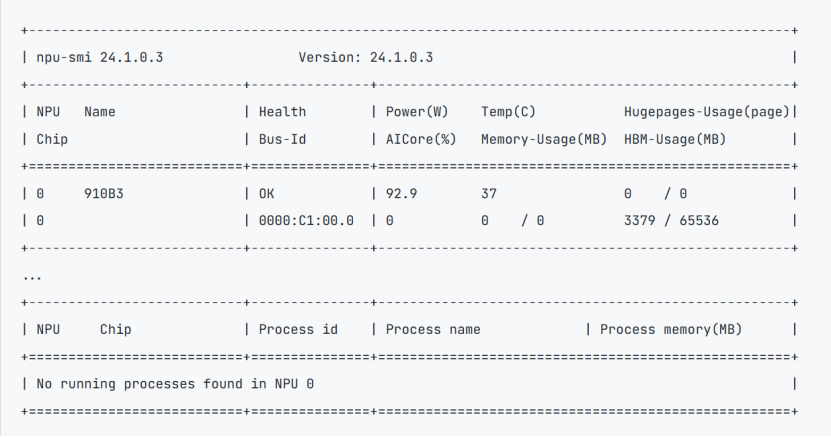
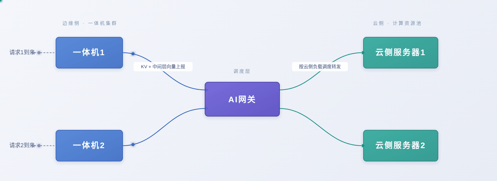

# Qwen3.6-27B

## 1 简介

Qwen3.6-27B是Qwen3.6系列中的密集混合Mamba-Transformer语言模型，融合了架构效率、强化学习规模和全球可访问性方面的突破。它们共享相同的混合注意力设计（GDN + 全注意力），因此在Ascend NPU上的部署对两个模型遵循相同的模式。它们适用于在Ascend NPU上运行的通用文本生成任务，如对话、内容创作和代码生成。

本文档将演示模型的边云协同特性的部署方式。

## 2 前提条件

### 2.1 模型权重

Qwen3.5-27B（BF16 版本）：需要 1 个 Atlas 800 A2（64GB × 8）节点，[下载模型权重](https://www.modelscope.cn/models/Qwen/Qwen3.6-27B)。

### 2.2 节点通信

部署边云特性环境，需要按照[安装指南](../install.md)中的***节点通信验证***章节验证多节点通信。

### 2.3 一体机配置
在使用一体机作为边侧设备时，需要以下配置。

(1) 在物理机上插入ko(仅一体机场景)
```
insmod /usr/lib/modules/$(uname -r)$/updates/npu_peermem.ko
```
(2) 准备white_list白名单（一体机和云侧服务器都需要）

创建white_list.json文件，在其中写入部署推理服务所需服务器的业务面ip。
```commandline
{
    "host_ip":[
        "x.x.x.x",
        "y.y.y.y"
    ]
}
```
(3) 准备ranktable（一体机和云侧服务器都需要）

参考以下创建文件，写入一体机host网卡和服务器的npu网卡信息。
```commandline
{
    "status":"completed",   // ranktable可用标识，completed为可用
    "version":"1.0"         // ranktable模板版本信息,当前必须为"1.0"
    "server_count":"2",  //参与推理的AI Server数目，此例中，只有两个AI Server
    "server_list":[              
        {      //以下为rank信息，一体机在前，服务器在后
            "server_id":"10.0.0.10",   //AI Server标识,即业务面网卡ip
            "container_ip":"10.0.0.10",
            "host_ip":"10.0.0.10",
            "para_net_position":"host",   //类型一体机参数面使用host网卡，为"host"; 服务器使用npu网卡，为"device"
            "para_net_protocol":"rdma",   //  统一使用rdma 
            "device":[
                {
                    "rank_id":"0",      //文件中从0开始计数
                    "device_id":"1",    // npu-smi info 查询出的npu卡id
                    "device_ip":"192.168.1.1",  // 一体机参数面host网卡ip
                    "device_port":"16666",
                    "host_port":60002
                }
            ]
        },
        {
            "server_id":"11.0.0.10",  
            "container_ip":"11.0.0.10",
            "host_ip":"11.0.0.10",
            "para_net_position":"device",
            "para_net_protocol":"rdma", 
            "device":[
                {
                    "rank_id":"1", 
                    "device_id":"0",
                    "device_ip":"192.168.2.2",  //npu网卡地址
                    "device_port":"16666",
                    "host_port":60002
                },
                {
                    "rank_id":"2", 
                    "device_id":"1",
                    "device_ip":"192.168.2.3",
                    "device_port":"16666",
                    "host_port":60002
                },
                {
                    "rank_id":"3", 
                    "device_id":"2",
                    "device_ip":"192.168.2.4",
                    "device_port":"16666",
                    "host_port":60002
                },
                {
                    "rank_id":"4", 
                    "device_id":"3",
                    "device_ip":"192.168.2.5",
                    "device_port":"16666",
                    "host_port":60002
                },
                {
                    "rank_id":"5", 
                    "device_id":"4",
                    "device_ip":"192.168.2.6",
                    "device_port":"16666",
                    "host_port":60002
                },
                {
                    "rank_id":"6", 
                    "device_id":"5",
                    "device_ip":"192.168.2.7",
                    "device_port":"16666",
                    "host_port":60002
                },
                {
                    "rank_id":"7", 
                    "device_id":"6",
                    "device_ip":"192.168.2.8",
                    "device_port":"16666",
                    "host_port":60002
                },
                {
                    "rank_id":"8", 
                    "device_id":"7",
                    "device_ip":"192.168.2.9",
                    "device_port":"16666",
                    "host_port":60002
                }
            ]   
        }
    ]
}
```

## 3 环境安装

我们提供了[编译后版本的镜像](https://quay.io/repository/kyoshiki/vllm-ascend-v23.0rc1),使用该镜像进行环境准备。

### 3.1 容器创建
参考以下命令创建容器。
```commandline
export IMAGE=quay.io/ascend/vllm-ascend:v0.23.0.rc1 #按情况修改
docker run -itd --privileged \
--name=<container-name> \
--ipc=host --net=host\
--shm-size 500g \
--device=/dev/davinci0 \
--device=/dev/davinci1 \
--device=/dev/davinci2 \
--device=/dev/davinci3 \
--device=/dev/davinci4 \
--device=/dev/davinci5 \
--device=/dev/davinci6 \
--device=/dev/davinci7 \
--device=/dev/davinci_manager \
--device=/dev/hisi_hdc \
--device /dev/devmm_svm \
-v /usr/local/Ascend/driver:/usr/local/Ascend/driver \
-v /usr/local/Ascend/firmware:/usr/local/Ascend/firmware \
-v /usr/local/sbin/npu‑smi:/usr/local/sbin/npu‑smi \
-v /usr/local/sbin:/usr/local/sbin \
-v /etc/hccn.conf:/etc/hccn.conf \
-v /home/weight:/home/weight \
-it $IMAGE bash
```

表 3.1 参数说明

| 参数                                                 | 参数说明                                                                                                                                                                                                                                                                                                                                   |
|------------------------------------------------------|--------------------------------------------------------------------------------------------------------------------------------------------------------------------------------------------------------------------------------------------------------------------------------------------------------------------------------------------|
| --name                                               | 设置容器名称。                                                                                                                                                                                                                                                                                                                             |
| --device                                             | 表示映射的设备，可以挂载一个或者多个设备。需要挂载的设备如下：/dev/davinciX：NPU 设备，X 是 ID 号，如：davinci0。/dev/davinci_manager：davinci 相关的管理设备。/dev/hisi_hdc：hdc 相关管理设备。/dev/devmm_svm：内存管理相关设备。可根据以下命令查询 device 个数及名称方式，根据需要绑定设备，修改上面命令中的 "--device=****"。`ll /dev/` |
| -v /usr/local/Ascend/driver:/usr/local/Ascend/driver | 将宿主机目录 “/usr/local/Ascend/driver” 挂载到容器，请根据驱动所在实际路径修改。                                                                                                                                                                                                                                                           |
| -v /path‑to‑weights:/path‑to‑weights                 | 设定权重挂载的路径，需要根据用户的情况修改。请将权重文件和数据集文件同时放置于该路径下。                                                                                                                                                                                                                                                   |

### 3.2 执行以下命令进入容器。

```commandline
docker exec -it <container-name> bash
```

### 3.3 进入一体机容器,在容器内安装roce驱动(仅一体机场景)
找到SP681网卡驱动中的roce驱动，执行以下命令安装。
```commandline
dpkg hiroce3-*.deb
```

## 4 服务部署

### 4.1 典型一边一云

#### 4.1.1 边云都是服务器部署
(1) 边侧服务器
```bash
#!/bin/bash
# ========== 环境变量 ==========
export VLLM_HOST_IP=<边侧业务面IP>
export GLOO_SOCKET_IFNAME=<边侧业务面网卡>
export TP_SOCKET_IFNAME=<边侧业务面网卡>
export HCCL_SOCKET_IFNAME=<边侧业务面网卡>
export MASTER_ADDR=<边侧业务面IP>

export PYTORCH_NPU_ALLOC_CONF="expandable_segments:True"
export HCCL_OP_EXPANSION_MODE="AIV"
export TORCH_DISTRIBUTED_DETAIL=DEBUG
export VLLM_WORKER_MULTIPROC_METHOD=spawn
export HCCL_BUFFSIZE=1024
export OMP_PROC_BIND=false
export OMP_NUM_THREADS=1
export LD_PRELOAD=/usr/lib/aarch64-linux-gnu/libjemalloc.so.2:$LD_PRELOAD
export TASK_QUEUE_ENABLE=1
export CODEBASE_DIR="/vllm-workspace"
export PYTHONPATH="${CODEBASE_DIR}/vllm-ascend:${CODEBASE_DIR}/vllm:${PYTHONPATH}"
export VLLM_ASCEND_ENABLE_PREFETCH_MLP=1
export VLLM_ASCEND_ENABLE_DENSE_OPTIMIZE=1
export VLLM_ASCEND_ENABLE_NZ=1
export VLLM_ASCEND_ENABLE_FUSED_MC2=1
export VLLM_ASCEND_GDN_FAST_PATH=1
export VLLM_ASCEND_GDN_MAX_PADDING_RATIO=2.0
export VLLM_ASCEND_GDN_MAX_H_OVERALLOC_RATIO=2.0
export VLLM_LOGGING_LEVEL=INFO

export ASCEND_RT_VISIBLE_DEVICES=0
export VLLM_ASCEND_LWD_PRE_OUT_PORT=7200
export VLLM_ASCEND_LWD_POST_OUT_PORT=7201

# ========== 启动命令 ==========
vllm serve <model_path> \
    --host 0.0.0.0 \
    --port <port> \
    --master-addr <边侧业务面IP> \
    --master-port <master-port> \
    --max-model-len 262144 \
    --served-model-name <自定义模型名称> \
    --pipeline-parallel-size 1 \
    --tensor-parallel-size 1 \
    --trust-remote-code --nnodes 2 --node-rank 0 --edge-npu-count 1 --cloud-npu-count 8 \
    --additional-config '{"enable_cpu_binding":true, "enable_weight_nz_layout":true, "lwd_config":{"enabled":true,"role":"edge","mode":"prefill_only","edge_head_tail_layers":[0,0]}}' \
    --compilation-config '{"cudagraph_mode":"NONE"}' \
    --max-num-seqs 196 \
    --max-num-batched-tokens 8192 \
    --async-scheduling \
    --gpu-memory-utilization 0.9
```
(2) 云侧服务器
```bash
#!/bin/bash
# ========== 环境变量 ==========
export VLLM_HOST_IP=<云侧业务面IP>
export GLOO_SOCKET_IFNAME=<云侧业务面网卡名>
export TP_SOCKET_IFNAME=<云侧业务面网卡名>
export HCCL_SOCKET_IFNAME=<云侧业务面网卡名>
export MASTER_ADDR=<边侧业务面IP>

export PYTORCH_NPU_ALLOC_CONF="expandable_segments:True"
export HCCL_OP_EXPANSION_MODE="AIV"
export TORCH_DISTRIBUTED_DETAIL=DEBUG
export VLLM_WORKER_MULTIPROC_METHOD=spawn
export HCCL_BUFFSIZE=1024
export OMP_PROC_BIND=false
export OMP_NUM_THREADS=1
export LD_PRELOAD=/usr/lib/aarch64-linux-gnu/libjemalloc.so.2:$LD_PRELOAD
export TASK_QUEUE_ENABLE=1
export CODEBASE_DIR="/vllm-workspace"
export PYTHONPATH="${CODEBASE_DIR}/vllm-ascend:${CODEBASE_DIR}/vllm:${PYTHONPATH}"
export VLLM_ASCEND_ENABLE_PREFETCH_MLP=1
export VLLM_ASCEND_ENABLE_DENSE_OPTIMIZE=1
export VLLM_ASCEND_ENABLE_NZ=1
export VLLM_ASCEND_ENABLE_FUSED_MC2=1
export VLLM_ASCEND_GDN_FAST_PATH=1
export VLLM_ASCEND_GDN_MAX_PADDING_RATIO=2.0
export VLLM_ASCEND_GDN_MAX_H_OVERALLOC_RATIO=2.0
export VLLM_ASCEND_EDGE_CLOUD_MERGE_PAYLOAD=1
export VLLM_LOGGING_LEVEL=INFO

export ASCEND_RT_VISIBLE_DEVICES=0,1,2,3,4,5,6,7
export VLLM_ASCEND_LWD_PRE_OUT_PORT=7200
export VLLM_ASCEND_LWD_POST_OUT_PORT=7201
export VLLM_ASCEND_LWD_PRE_OUT_HOST=<云侧IP>

# ========== 启动命令 ==========
vllm serve <model_path> \
    --master-addr <边侧业务面IP> \
    --master-port <master-port> \
    --max-model-len 262144 \
    --served-model-name <自定义模型名称> \
    -pp 2 \
    --tensor-parallel-size 8 \
    --trust-remote-code --nnodes 2 --node-rank 1  --edge-npu-count 1 --cloud-npu-count 8 \
    --additional-config '{"enable_cpu_binding":true, "enable_weight_nz_layout":true, "lwd_config":{"enabled":true,"role":"cloud","mode":"prefill_only","edge_head_tail_layers":[0,0]}}' \
    --compilation-config '{"cudagraph_mode":"FULL_DECODE_ONLY","cudagraph_capture_sizes":[4,8,12,16,20,24,28,32,36,40,44,48,52,56,60]}' \
    --max-num-seqs 196 \
    --max-num-batched-tokens 8192 \
    --async-scheduling \
    --gpu-memory-utilization 0.9 \
    --speculative-config '{"num_speculative_tokens": 3, "method":"qwen3_5_mtp", "enforce_eager": true}'
```

#### 4.1.2 边侧使用一体机，云侧使用服务器
(1) 边侧一体机
```bash
#!/bin/bash
# ========== 环境变量 ==========
export VLLM_HOST_IP=<边侧业务面IP>
export GLOO_SOCKET_IFNAME=<边侧业务面网卡名>
export TP_SOCKET_IFNAME=<边侧业务面网卡名>
export HCCL_SOCKET_IFNAME=<边侧业务面网卡名>
export MASTER_ADDR=<边侧业务面IP>

export PYTORCH_NPU_ALLOC_CONF="expandable_segments:True"
export HCCL_OP_EXPANSION_MODE="AIV"
export TORCH_DISTRIBUTED_DETAIL=DEBUG
export VLLM_WORKER_MULTIPROC_METHOD=spawn
export HCCL_BUFFSIZE=1024
export OMP_PROC_BIND=false
export OMP_NUM_THREADS=1
export LD_PRELOAD=/usr/lib/aarch64-linux-gnu/libjemalloc.so.2:$LD_PRELOAD
export TASK_QUEUE_ENABLE=1
export CODEBASE_DIR="/vllm-workspace"
export PYTHONPATH="${CODEBASE_DIR}/vllm-ascend:${CODEBASE_DIR}/vllm:${PYTHONPATH}"
export VLLM_ASCEND_ENABLE_PREFETCH_MLP=1
export VLLM_ASCEND_ENABLE_DENSE_OPTIMIZE=1
export VLLM_ASCEND_ENABLE_NZ=1
export VLLM_ASCEND_ENABLE_FUSED_MC2=1
export VLLM_ASCEND_GDN_FAST_PATH=1
export VLLM_ASCEND_GDN_MAX_PADDING_RATIO=2.0
export VLLM_ASCEND_GDN_MAX_H_OVERALLOC_RATIO=2.0
export VLLM_LOGGING_LEVEL=INFO

export ASCEND_RT_VISIBLE_DEVICES=0
export VLLM_ASCEND_LWD_PRE_OUT_PORT=7200
export VLLM_ASCEND_LWD_POST_OUT_PORT=7201

#一体机配置
export HCCL_WHITELIST_DISABLE="0"
export HCCL_WHITELIST_FILE="<白名单文件路径>"
export RANK_TABLE_FILE='<rank_table文件路径>'
export HCCL_IF_BASE_PORT=<HCCL_IF_BASE_PORT>

# ========== 启动命令 ==========
vllm serve <model_path> \
    --host 0.0.0.0 \
    --port <port> \
    --master-addr <边侧业务面IP> \
    --master-port <master-port> \
    --max-model-len 262144 \
    --served-model-name <自定义模型名称> \
    --pipeline-parallel-size 1 \
    --tensor-parallel-size 1 \
    --trust-remote-code --nnodes 2 --node-rank 0 --edge-npu-count 1 --cloud-npu-count 4 \
    --additional-config '{"enable_cpu_binding":true, "enable_weight_nz_layout":true, "lwd_config":{"enabled":true,"role":"edge","mode":"prefill_only","edge_head_tail_layers":[0,0]}}' \
    --compilation-config '{"cudagraph_mode":"NONE"}' \
    --max-num-seqs 196 \
    --max-num-batched-tokens 8192 \
    --async-scheduling \
    --gpu-memory-utilization 0.9
```

(2) 云侧服务器
```bash
#!/bin/bash
# ========== 环境变量 ==========
export VLLM_HOST_IP=<云侧业务面IP>
export GLOO_SOCKET_IFNAME=<云侧业务面网卡名>
export TP_SOCKET_IFNAME=<云侧业务面网卡名>
export HCCL_SOCKET_IFNAME=<云侧业务面网卡名>
export MASTER_ADDR=<边侧业务面IP>

export PYTORCH_NPU_ALLOC_CONF="expandable_segments:True"
export HCCL_OP_EXPANSION_MODE="AIV"
export TORCH_DISTRIBUTED_DETAIL=DEBUG
export VLLM_WORKER_MULTIPROC_METHOD=spawn
export HCCL_BUFFSIZE=1024
export OMP_PROC_BIND=false
export OMP_NUM_THREADS=1
export LD_PRELOAD=/usr/lib/aarch64-linux-gnu/libjemalloc.so.2:$LD_PRELOAD
export TASK_QUEUE_ENABLE=1
export CODEBASE_DIR="/vllm-workspace"
export PYTHONPATH="${CODEBASE_DIR}/vllm-ascend:${CODEBASE_DIR}/vllm:${PYTHONPATH}"
export VLLM_ASCEND_ENABLE_PREFETCH_MLP=1
export VLLM_ASCEND_ENABLE_DENSE_OPTIMIZE=1
export VLLM_ASCEND_ENABLE_NZ=1
export VLLM_ASCEND_ENABLE_FUSED_MC2=1
export VLLM_ASCEND_GDN_FAST_PATH=1
export VLLM_ASCEND_GDN_MAX_PADDING_RATIO=2.0
export VLLM_ASCEND_GDN_MAX_H_OVERALLOC_RATIO=2.0
export VLLM_ASCEND_EDGE_CLOUD_MERGE_PAYLOAD=1
export VLLM_LOGGING_LEVEL=INFO

export ASCEND_RT_VISIBLE_DEVICES=0,1,2,3
export VLLM_ASCEND_LWD_PRE_OUT_PORT=7200
export VLLM_ASCEND_LWD_POST_OUT_PORT=7201
export VLLM_ASCEND_LWD_PRE_OUT_HOST=<云侧业务面IP>

#一体机配置
export HCCL_WHITELIST_DISABLE="0"
export HCCL_WHITELIST_FILE="<白名单文件路径>"
export RANK_TABLE_FILE='<rank_table文件路径>'

# ========== 启动命令 ==========
vllm serve <model_path> \
    --master-addr <边侧业务面IP> \
    --master-port <master-port> \
    --max-model-len 262144 \
    --served-model-name <自定义模型名称> \
    -pp 2 \
    --tensor-parallel-size 4 \
    --trust-remote-code --nnodes 2 --node-rank 1  --edge-npu-count 1 --cloud-npu-count 4 \
    --additional-config '{"enable_cpu_binding":true, "enable_weight_nz_layout":true, "lwd_config":{"enabled":true,"role":"cloud","mode":"prefill_only","edge_head_tail_layers":[0,0]}}' \
    --compilation-config '{"cudagraph_mode":"FULL_DECODE_ONLY","cudagraph_capture_sizes":[4,8,12,16,20,24,28,32,36,40,44,48,52,56,60,64,68,72,76,80,84,88,92,96,100,104,108,112,116,120,124,128,132,136,140,144,148,152,156,160,164,168,172,176,180,184,188,192,196,200,204,208,212,216,220,224,228,232,236,240,244,248,252,256,260,264,268,272,276,280,284,288,292,296,300,304,308,312,316,320,324,328,332,336,340,344,348,352,356,360,364,368,372,376,380,384,388,392,396,400,404,408,412,416,420,424,428,432,436,440,444,448,452,456,460,464,468,472,476,480,484,488,492,496,500,504,508,512,516,520,524,528,532,536,540,544,548,552,556,560,564,568,572,576,580,584,588,592,596,600,604,608,612,616,620,624,628,632,636,640,644,648,652,656,660,664,668,672,676,680,684,688,692,696,700,704,708,712,716,720]}' \
    --max-num-seqs 196 \
    --max-num-batched-tokens 8192 \
    --async-scheduling \
    --gpu-memory-utilization 0.9 \
    --speculative-config '{"num_speculative_tokens": 3, "method":"qwen3_5_mtp", "enforce_eager": true}'
```

表4.1.1 关键配置参数说明


| 配置项                    | 配置说明                                                                                                                 |
|---------------------------|--------------------------------------------------------------------------------------------------------------------------|
| ASCEND_RT_VISIBLE_DEVICES | 表示启用哪几张卡。对于每个模型实例分配的 npuIds，使用芯片逻辑 ID 表示。                                                  |
| HCCL_WHITELIST_FILE       | 白名单文件路径，存放各服务器的业务面地址。                                                                               |
| RANK_TABLE_FILE           | ranktable的json格式文件路径，存放各服务器的业务面和参数面信息。                                                          |
| HCCL_IF_BASE_PORT         | 一体机hccl通信端口，需要根据使用npu卡的物理id（下图中最左侧的NPU号）进行修改。从1号卡开始为16657，卡号每加1，端口号减1。 |
| --served‑model‑name       | 模型名称。                                                                                                               |
| --host                    | 模型服务 IP，0.0.0.0 表示不指定 IP 地址，该服务器的 IP 皆可访问。                                                        |
| --port                    | 模型服务端口号。                                                                                                         |
| --max‑model‑len           | 模型服务上下文长度。                                                                                                     |



### 4.2 多实例
因为边云特性在边侧占用很少算力，所以可在边侧部署多个容器，创建多个服务和不同云侧服务器算卡对接，以下以一体机作为边侧算力，云侧使用不同服务器为例部署两实例：

(1) 边侧一体机容器1
```commandline
#!/bin/bash
export VLLM_HOST_IP=<边侧业务面IP>
export GLOO_SOCKET_IFNAME=<边侧业务面网卡>
export TP_SOCKET_IFNAME=<边侧业务面网卡>
export HCCL_SOCKET_IFNAME=<边侧业务面网卡>
export MASTER_ADDR=<边侧业务面IP>

export PYTORCH_NPU_ALLOC_CONF="expandable_segments:True"
export HCCL_OP_EXPANSION_MODE="AIV"
export TORCH_DISTRIBUTED_DETAIL=DEBUG
export VLLM_WORKER_MULTIPROC_METHOD=spawn
export HCCL_BUFFSIZE=1024
export OMP_PROC_BIND=false
export OMP_NUM_THREADS=1
export LD_PRELOAD=/usr/lib/aarch64-linux-gnu/libjemalloc.so.2:$LD_PRELOAD
export TASK_QUEUE_ENABLE=1
export CODEBASE_DIR="/vllm-workspace"
export PYTHONPATH="${CODEBASE_DIR}/vllm-ascend:${CODEBASE_DIR}/vllm:${PYTHONPATH}"
export VLLM_ASCEND_ENABLE_PREFETCH_MLP=1
export VLLM_ASCEND_ENABLE_DENSE_OPTIMIZE=1
export VLLM_ASCEND_ENABLE_NZ=1
export VLLM_ASCEND_ENABLE_FUSED_MC2=1
export VLLM_ASCEND_GDN_FAST_PATH=1
export VLLM_ASCEND_GDN_MAX_PADDING_RATIO=2.0
export VLLM_ASCEND_GDN_MAX_H_OVERALLOC_RATIO=2.0
export VLLM_LOGGING_LEVEL=INFO
export VLLM_ASCEND_LWD_HELLO_TIMEOUT_S=2400

export ASCEND_RT_VISIBLE_DEVICES=0
export VLLM_ASCEND_LWD_PRE_OUT_PORT=5293
export VLLM_ASCEND_LWD_POST_OUT_PORT=5294
export HCCL_NPU_SOCKET_PORT_RANGE=18710-18730

#一体机配置
export HCCL_WHITELIST_DISABLE="0"
export HCCL_WHITELIST_FILE="<白名单文件路径>"
export RANK_TABLE_FILE="<rank_table文件路径>"
export HCCL_IF_BASE_PORT=<HCCL_IF_BASE_PORT>

vllm serve <model_path> \
    --host 0.0.0.0 \
    --port 8123 \
    --master-addr <边侧业务面IP> \
    --api-server-count 2 \
    --api-server-rpc-port  23657 \
    --master-port 23657 \
    --pipeline-parallel-size 1 \
    --tensor-parallel-size 1 \
    --max-model-len 262144 \
    --served-model-name <自定义模型名称> \
    --trust-remote-code --nnodes 2 --node-rank 0 --edge-npu-count 1 --cloud-npu-count 8  --instance_parallel_size 2 --instance_parallel_start_rank 0 \
    --additional-config '{"enable_cpu_binding":true, "enable_weight_nz_layout":true, "lwd_config":{"enabled":true,"role":"edge","mode":"prefill_only","edge_head_tail_layers":[0,0]}}' \
    --compilation-config '{"cudagraph_mode":"NONE"}' \
    --max-num-seqs 230 \
    --max-num-batched-tokens 8192 \
    --async-scheduling \
    --gpu-memory-utilization 0.92 \
    --chat-template /xxxx/Qwen3.6-27B/chat_template.jinja \
    --default-chat-template-kwargs '{"enable_thinking": false}' \
    --reasoning-parser qwen3 \
    --enable-auto-tool-choice \
    --tool-call-parser qwen3_coder \
```
(2) 边侧一体机容器2
```commandline
#!/bin/bash
export VLLM_HOST_IP=<边侧业务面IP>
export GLOO_SOCKET_IFNAME=<边侧业务面网卡>
export TP_SOCKET_IFNAME=<边侧业务面网卡>
export HCCL_SOCKET_IFNAME=<边侧业务面网卡>
export MASTER_ADDR=<边侧业务面IP>

export PYTORCH_NPU_ALLOC_CONF="expandable_segments:True"
export HCCL_OP_EXPANSION_MODE="AIV"
export TORCH_DISTRIBUTED_DETAIL=DEBUG
export VLLM_WORKER_MULTIPROC_METHOD=spawn
export HCCL_BUFFSIZE=1024
export OMP_PROC_BIND=false
export OMP_NUM_THREADS=1
export LD_PRELOAD=/usr/lib/aarch64-linux-gnu/libjemalloc.so.2:$LD_PRELOAD
export TASK_QUEUE_ENABLE=1
export CODEBASE_DIR="/vllm-workspace"
export PYTHONPATH="${CODEBASE_DIR}/vllm-ascend:${CODEBASE_DIR}/vllm:${PYTHONPATH}"
export VLLM_ASCEND_ENABLE_PREFETCH_MLP=1
export VLLM_ASCEND_ENABLE_DENSE_OPTIMIZE=1
export VLLM_ASCEND_ENABLE_NZ=1
export VLLM_ASCEND_ENABLE_FUSED_MC2=1
export VLLM_ASCEND_GDN_FAST_PATH=1
export VLLM_ASCEND_GDN_MAX_PADDING_RATIO=2.0
export VLLM_ASCEND_GDN_MAX_H_OVERALLOC_RATIO=2.0
export VLLM_LOGGING_LEVEL=INFO
export VLLM_ASCEND_LWD_HELLO_TIMEOUT_S=2400

export ASCEND_RT_VISIBLE_DEVICES=0
export VLLM_ASCEND_LWD_PRE_OUT_PORT=5293
export VLLM_ASCEND_LWD_POST_OUT_PORT=5294
export HCCL_NPU_SOCKET_PORT_RANGE=18710-18730

#一体机配置
export HCCL_WHITELIST_DISABLE="0"
export HCCL_WHITELIST_FILE="<白名单文件路径>"
export RANK_TABLE_FILE="<rank_table文件路径>"
export HCCL_IF_BASE_PORT=<HCCL_IF_BASE_PORT>

vllm serve <model_path> \
    --host 0.0.0.0 \
    --port 8124 \
    --master-addr <边侧业务面IP> \
    --api-server-count 2 \
    --api-server-attach  <边侧业务面IP>:23657 \
    --master-port 23657 \
    --pipeline-parallel-size 1 \
    --tensor-parallel-size 1 \
    --max-model-len 262144 \
    --served-model-name <自定义模型名称> \
    --trust-remote-code --nnodes 2 --node-rank 0 --edge-npu-count 1 --cloud-npu-count 8   --instance_parallel_size 2 --instance_parallel_start_rank 1 \
    --additional-config '{"enable_cpu_binding":true, "enable_weight_nz_layout":true, "lwd_config":{"enabled":true,"role":"edge","mode":"prefill_only","edge_head_tail_layers":[0,0]}}' \
    --compilation-config '{"cudagraph_mode":"NONE"}' \
    --max-num-seqs 230 \
    --max-num-batched-tokens 8192 \
    --async-scheduling \
    --gpu-memory-utilization 0.92 \
    --chat-template /xxx/Qwen3.6-27B/chat_template.jinja \
    --default-chat-template-kwargs '{"enable_thinking": false}' \
    --reasoning-parser qwen3 \
    --enable-auto-tool-choice \
    --tool-call-parser qwen3_coder \
```
(3) 云侧服务器1
```commandline
#!/bin/bash
export VLLM_HOST_IP=<云1业务面IP>
export GLOO_SOCKET_IFNAME=<云1业务面网卡>
export TP_SOCKET_IFNAME=<云1业务面网卡>
export HCCL_SOCKET_IFNAME=<云1业务面网卡>
export MASTER_ADDR=<边侧业务面IP>

export PYTORCH_NPU_ALLOC_CONF="expandable_segments:True"
export HCCL_OP_EXPANSION_MODE="AIV"
# 增大分布式超时
export TORCH_DISTRIBUTED_DETAIL=DEBUG
export VLLM_WORKER_MULTIPROC_METHOD=spawn
export HCCL_BUFFSIZE=1024
export OMP_PROC_BIND=false
export OMP_NUM_THREADS=1
export LD_PRELOAD=/usr/lib/aarch64-linux-gnu/libjemalloc.so.2:$LD_PRELOAD
export TASK_QUEUE_ENABLE=1
export CODEBASE_DIR="/vllm-workspace"
export PYTHONPATH="${CODEBASE_DIR}/vllm-ascend:${CODEBASE_DIR}/vllm:${PYTHONPATH}"
export VLLM_ASCEND_ENABLE_PREFETCH_MLP=1
export VLLM_ASCEND_ENABLE_DENSE_OPTIMIZE=1
export VLLM_ASCEND_ENABLE_NZ=1
export VLLM_ASCEND_ENABLE_FUSED_MC2=1
export VLLM_ASCEND_GDN_FAST_PATH=1
export VLLM_ASCEND_GDN_MAX_PADDING_RATIO=2.0
export VLLM_ASCEND_GDN_MAX_H_OVERALLOC_RATIO=2.0
export VLLM_LOGGING_LEVEL=INFO
export VLLM_ASCEND_LWD_HELLO_TIMEOUT_S=2400

export ASCEND_RT_VISIBLE_DEVICES=0,1,2,3
export VLLM_ASCEND_LWD_PRE_OUT_PORT=5293
export VLLM_ASCEND_LWD_POST_OUT_PORT=5294
export VLLM_ASCEND_LWD_PRE_OUT_HOST=<云1业务面IP>
export HCCL_NPU_SOCKET_PORT_RANGE=18710-18730

#一体机配置
export HCCL_WHITELIST_DISABLE="0"
export HCCL_WHITELIST_FILE="<白名单文件路径>"
export RANK_TABLE_FILE="<rank_table文件路径>"

vllm serve <model_path> \
    --master-addr <边侧业务面IP> \
    --master-port 23657 \
    -pp 2 \
    --tensor-parallel-size 4 \
    --max-model-len 262144 \
    --served-model-name <自定义模型名称> \
    --trust-remote-code --nnodes 2 --node-rank 1  --edge-npu-count 1 --cloud-npu-count 8 --instance_parallel_size 2 --instance_parallel_start_rank 0 \
    --additional-config '{"enable_cpu_binding":true, "enable_weight_nz_layout":true, "lwd_config":{"enabled":true,"role":"cloud","mode":"prefill_only","edge_head_tail_layers":[0,0]}}' \
    --compilation-config '{"cudagraph_mode":"FULL_DECODE_ONLY","cudagraph_capture_sizes":[4,8,12,16,20, 24, 28, 32, 36, 40, 44, 48, 52, 56, 60, 64, 68, 72, 76, 80, 84, 88, 92, 96, 100, 104, 108, 112, 116, 120, 124, 128, 132, 136, 140, 144, 148, 152, 156, 160, 164, 168, 172, 176, 180, 184, 188, 192, 196, 200, 204, 208, 212, 216, 220, 224, 228, 232, 236, 240, 244, 248, 252, 256, 260, 264, 268, 272, 276, 280, 284, 288, 292, 296, 300, 304, 308, 312, 316, 320, 324, 328, 332, 336, 340, 344, 348, 352, 356, 360, 364, 368, 372, 376, 380, 384, 388, 392, 396, 400, 404, 408, 412, 416, 420, 424, 428, 432, 436, 440, 444, 448, 452, 456, 460, 464, 468, 472, 476, 480, 484, 488, 492, 496, 500, 504, 508, 512, 516, 520, 524, 528, 532, 536, 540, 544, 548, 552, 556, 560, 564, 568, 572, 576, 580, 584, 588, 592, 596, 600, 604, 608, 612, 616, 620, 624, 628, 632, 636, 640, 644, 648, 652, 656, 660, 664, 668, 672, 676, 680, 684, 688, 692, 696, 700, 704, 708, 712, 716, 720]}' \
    --max-num-seqs 230 \
    --max-num-batched-tokens 8192 \
    --async-scheduling \
    --gpu-memory-utilization 0.92 \
    --speculative-config '{"num_speculative_tokens": 3,"method": "mtp"}' \
    --chat-template /xxx/Qwen3.6-27B/chat_template.jinja \
    --default-chat-template-kwargs '{"enable_thinking": false}' \
    --reasoning-parser qwen3 \
    --enable-auto-tool-choice \
    --tool-call-parser qwen3_coder \
```
(4) 云侧服务器2
```commandline
#!/bin/bash
export VLLM_HOST_IP=<云2业务面IP>
export GLOO_SOCKET_IFNAME=<云2业务面网卡>
export TP_SOCKET_IFNAME=<云2业务面网卡>
export HCCL_SOCKET_IFNAME=<云2业务面网卡>
export MASTER_ADDR=<边侧业务面IP>

export PYTORCH_NPU_ALLOC_CONF="expandable_segments:True"
export HCCL_OP_EXPANSION_MODE="AIV"
# 增大分布式超时
export TORCH_DISTRIBUTED_DETAIL=DEBUG
export VLLM_WORKER_MULTIPROC_METHOD=spawn
export HCCL_BUFFSIZE=1024
export OMP_PROC_BIND=false
export OMP_NUM_THREADS=1
export LD_PRELOAD=/usr/lib/aarch64-linux-gnu/libjemalloc.so.2:$LD_PRELOAD
export TASK_QUEUE_ENABLE=1
export CODEBASE_DIR="/vllm-workspace"
export PYTHONPATH="${CODEBASE_DIR}/vllm-ascend:${CODEBASE_DIR}/vllm:${PYTHONPATH}"
export VLLM_ASCEND_ENABLE_PREFETCH_MLP=1
export VLLM_ASCEND_ENABLE_DENSE_OPTIMIZE=1
export VLLM_ASCEND_ENABLE_NZ=1
export VLLM_ASCEND_ENABLE_FUSED_MC2=1
export VLLM_ASCEND_GDN_FAST_PATH=1
export VLLM_ASCEND_GDN_MAX_PADDING_RATIO=2.0
export VLLM_ASCEND_GDN_MAX_H_OVERALLOC_RATIO=2.0
export VLLM_LOGGING_LEVEL=INFO
export VLLM_ASCEND_LWD_HELLO_TIMEOUT_S=2400

export ASCEND_RT_VISIBLE_DEVICES=4,5,6,7
export VLLM_ASCEND_LWD_PRE_OUT_PORT=5293
export VLLM_ASCEND_LWD_POST_OUT_PORT=5294
export VLLM_ASCEND_LWD_PRE_OUT_HOST=<云2业务面IP>
export HCCL_NPU_SOCKET_PORT_RANGE=18710-18730

#一体机配置
export HCCL_WHITELIST_DISABLE="0"
export HCCL_WHITELIST_FILE="<白名单文件路径>"
export RANK_TABLE_FILE="<rank_table文件路径>"

vllm serve <model_path> \
    --master-addr <边侧业务面IP> \
    --master-port 23657 \
    -pp 2 \
    --tensor-parallel-size 4 \
    --max-model-len 262144 \
    --served-model-name <自定义模型名称> \
    --trust-remote-code --nnodes 2 --node-rank 1  --edge-npu-count 1 --cloud-npu-count 8 --instance_parallel_size 2 --instance_parallel_start_rank 1 \
    --additional-config '{"enable_cpu_binding":true, "enable_weight_nz_layout":true, "lwd_config":{"enabled":true,"role":"cloud","mode":"prefill_only","edge_head_tail_layers":[0,0]}}' \
    --compilation-config '{"cudagraph_mode":"FULL_DECODE_ONLY","cudagraph_capture_sizes":[4,8,12,16,20, 24, 28, 32, 36, 40, 44, 48, 52, 56, 60, 64, 68, 72, 76, 80, 84, 88, 92, 96, 100, 104, 108, 112, 116, 120, 124, 128, 132, 136, 140, 144, 148, 152, 156, 160, 164, 168, 172, 176, 180, 184, 188, 192, 196, 200, 204, 208, 212, 216, 220, 224, 228, 232, 236, 240, 244, 248, 252, 256, 260, 264, 268, 272, 276, 280, 284, 288, 292, 296, 300, 304, 308, 312, 316, 320, 324, 328, 332, 336, 340, 344, 348, 352, 356, 360, 364, 368, 372, 376, 380, 384, 388, 392, 396, 400, 404, 408, 412, 416, 420, 424, 428, 432, 436, 440, 444, 448, 452, 456, 460, 464, 468, 472, 476, 480, 484, 488, 492, 496, 500, 504, 508, 512, 516, 520, 524, 528, 532, 536, 540, 544, 548, 552, 556, 560, 564, 568, 572, 576, 580, 584, 588, 592, 596, 600, 604, 608, 612, 616, 620, 624, 628, 632, 636, 640, 644, 648, 652, 656, 660, 664, 668, 672, 676, 680, 684, 688, 692, 696, 700, 704, 708, 712, 716, 720]}' \
    --max-num-seqs 230 \
    --max-num-batched-tokens 8192 \
    --async-scheduling \
    --gpu-memory-utilization 0.92 \
    --speculative-config '{"num_speculative_tokens": 3,"method": "mtp"}' \
    --chat-template /xxx/Qwen3.6-27B/chat_template.jinja \
    --default-chat-template-kwargs '{"enable_thinking": false}' \
    --reasoning-parser qwen3 \
    --enable-auto-tool-choice \
    --tool-call-parser qwen3_coder \
```
表4.2.1 关键配置参数说明

| 配置项                    | 配置说明                                                                                          |
|---------------------------|---------------------------------------------------------------------------------------------------|
| ASCEND_RT_VISIBLE_DEVICES | 表示启用哪几张卡。对于每个模型实例分配的 npuIds，使用芯片逻辑 ID 表示。                           |
| HCCL_WHITELIST_FILE       | 白名单文件路径，存放各服务器的业务面地址。                                                        |
| RANK_TABLE_FILE           | ranktable的json格式文件路径，存放各服务器的业务面和参数面信息。                                   |
| HCCL_IF_BASE_PORT         | 一体机hccl通信端口，需要根据使用npu卡的物理id进行修改。从1号卡开始为16657，卡号每加1，端口号减1。 |
| --served‑model‑name       | 模型名称。                                                                                        |
| --host                    | 模型服务 IP，0.0.0.0 表示不指定 IP 地址，该服务器的 IP 皆可访问。                                 |
| --port                    | 模型服务端口号。                                                                                  |
| --max‑model‑len           | 模型服务上下文长度。                                                                              |
| --api-server-count        | 边侧实例数。                                                                                      |
| --api-server-rpc-port     | 实例0和其他实例通信端口。                                                                         |
| --api-server-attach       | 非实例0和实例0通信ip和端口。                                                                      |


### 4.3 云侧复用

部署模型时云侧设备算例如果有空闲，可云侧复用部署多个服务，具体流程如下图所示。服务器到达边侧后，由一体机进行处理生成kv和中间层向量，后转发到AI网关，由AI网关根据云侧服务器负载情况转发到合适的云侧服务器进行处理。在无AI网关情况下，可在边侧配置直接转发到云侧服务器。



以下以多个一体机服务作为边侧算力，云侧使用一台服务器为例部署：
(1) 创建边云全局共享的静态角色注册表，规定边云的拓扑结构（yaml格式文件）
```commandline
world:
    master_addr:<node0 IP,复用边1业务面IP>
    master_port:<master_port>
edge:
    -id:0
    addr:<边1业务面IP>
    ranks:[0] #使用npu的卡号
    -id:1
    addr:<边2业务面IP>
    ranks:[0] #使用npu的卡号
clouds:
    -id:0
    addr:<云侧业务面IP>
    ranks:[0,1,2,3] #使用npu的卡号
    zmq_base_port:<port> #假设由n个边，需要占用[port,port+2*n]区间内的端口，确保这些端口无占用
```
(2) 创建租户密钥文件tenant_key_file隔离不同来源的kv
只在边侧持有，按照十六进制写入，二进制读取，需要≥16字节，例如`7a2f9d4c810e3b56290f74ac58bd32071ce694085f213bc709426da518c4963`。

(3) 服务部署

a. 边侧一体机1
```commandline
#!/bin/bash
export VLLM_HOST_IP=<边1业务面IP>
export GLOO_SOCKET_IFNAME=<边1业务面网卡>
export TP_SOCKET_IFNAME=<边1业务面网卡>
export HCCL_SOCKET_IFNAME=<边1业务面网卡>
export PYTORCH_NPU_ALLOC_CONF="expandable_segments:True"
export HCCL_OP_EXPANSION_MODE="AIV"
export MASTER_ADDR=<node0 IP>

export TORCH_DISTRIBUTED_DETAIL=DEBUG
export VLLM_WORKER_MULTIPROC_METHOD=spawn
export HCCL_BUFFSIZE=1024
export OMP_PROC_BIND=false
export OMP_NUM_THREADS=1
export LD_PRELOAD=/usr/lib/aarch64-linux-gnu/libjemalloc.so.2:$LD_PRELOAD
export TASK_QUEUE_ENABLE=1
export CODEBASE_DIR="/vllm-workspace"
export PYTHONPATH="${CODEBASE_DIR}/vllm-ascend:${CODEBASE_DIR}/vllm:${PYTHONPATH}"
export VLLM_ASCEND_ENABLE_PREFETCH_MLP=1
export VLLM_ASCEND_ENABLE_DENSE_OPTIMIZE=1
export VLLM_ASCEND_GDN_FAST_PATH=1
export VLLM_ASCEND_GDN_MAX_PADDING_RATIO=2.0
export VLLM_ASCEND_GDN_MAX_H_OVERALLOC_RATIO=2.0
export VLLM_LOGGING_LEVEL=ERROR
export VLLM_ASCEND_LWD_DEBUG=1
export VLLM_ASCEND_LWD_DBG_SEND=0

export ASCEND_RT_VISIBLE_DEVICES=0
export VLLM_ASCEND_LWD_PRE_OUT_PORT=6053
export VLLM_ASCEND_LWD_POST_OUT_PORT=6054

#一体机配置
export HCCL_WHITELIST_DISABLE="0"
export HCCL_WHITELIST_FILE="<白名单文件路径>"
export RANK_TABLE_FILE="<rank_table文件路径>"
export HCCL_IF_BASE_PORT=<HCCL_IF_BASE_PORT>

vllm serve <model_path> \
    --host 0.0.0.0 \
    --port 8094 \
    --master-addr <node0 IP> \
    --master-port 29525 \
    --max-model-len 262144 \
    --served-model-name <自定义模型名称> \
    --pipeline-parallel-size 1 \
    --tensor-parallel-size 1 \
    --trust-remote-code --nnodes 3 --node-rank 0 --edge-npu-count 1 --cloud-npu-count 4 \
    --edge-id 0 \
    --no-enable-prefix-caching \
    --role-registry "<边云全局共享的静态角色注册表.yaml>" \
    --additional-config '{"enable_cpu_binding":true, "enable_weight_nz_layout":true, "lwd_config":{"enabled":true,"role":"edge","mode":"prefill_only","edge_head_tail_layers":[0,0]}, "lwd_coordination": {"enabled": false, "control_url": "<控制url,此场景填写云侧服务监听地址>", "tenant_key_file": "<租户密钥文件>", "consumer_id": "enterprise-a-edge0", "connect_timeout":5.0}}' \
    --compilation-config '{"cudagraph_mode":"NONE"}' \
    --max-num-seqs 230 \
    --max-num-batched-tokens 8192 \
    --async-scheduling \
    --gpu-memory-utilization 0.95 \
```
b. 边侧一体机2
```commandline
#!/bin/bash
export VLLM_HOST_IP=<边2业务面IP>
export GLOO_SOCKET_IFNAME=<边2业务面网卡>
export TP_SOCKET_IFNAME=<边2业务面网卡>
export HCCL_SOCKET_IFNAME=<边2业务面网卡>
export MASTER_ADDR=<node0 IP>

export PYTORCH_NPU_ALLOC_CONF="expandable_segments:True"
export HCCL_OP_EXPANSION_MODE="AIV"
export TORCH_DISTRIBUTED_DETAIL=DEBUG
export VLLM_WORKER_MULTIPROC_METHOD=spawn
export HCCL_BUFFSIZE=1024
export OMP_PROC_BIND=false
export OMP_NUM_THREADS=1
export LD_PRELOAD=/usr/lib/aarch64-linux-gnu/libjemalloc.so.2:$LD_PRELOAD
export TASK_QUEUE_ENABLE=1
export CODEBASE_DIR="/vllm-workspace"
export PYTHONPATH="${CODEBASE_DIR}/vllm-ascend:${CODEBASE_DIR}/vllm:${PYTHONPATH}"
export VLLM_ASCEND_ENABLE_PREFETCH_MLP=1
export VLLM_ASCEND_ENABLE_DENSE_OPTIMIZE=1
export VLLM_ASCEND_GDN_FAST_PATH=1
export VLLM_ASCEND_GDN_MAX_PADDING_RATIO=2.0
export VLLM_ASCEND_GDN_MAX_H_OVERALLOC_RATIO=2.0
export VLLM_LOGGING_LEVEL=ERROR
export VLLM_ASCEND_LWD_DBG_SEND=0
export VLLM_ASCEND_LWD_DEBUG=1

export ASCEND_RT_VISIBLE_DEVICES=1
export VLLM_ASCEND_LWD_PRE_OUT_PORT=6053
export VLLM_ASCEND_LWD_POST_OUT_PORT=6054

#一体机配置
export HCCL_WHITELIST_DISABLE="0"
export HCCL_WHITELIST_FILE="<白名单文件路径>"
export RANK_TABLE_FILE="<rank_table文件路径>"
export HCCL_IF_BASE_PORT=<HCCL_IF_BASE_PORT>

vllm serve <model_path> \
    --host 0.0.0.0 \
    --port 8095 \
    --master-addr <node0 IP> \
    --master-port 29525 \
    --max-model-len 262144 \
    --served-model-name <自定义模型名称> \
    --pipeline-parallel-size 1 \
    --tensor-parallel-size 1 \
    --trust-remote-code --nnodes 3 --node-rank 1 --edge-npu-count 1 --cloud-npu-count 4 \
    --edge-id 1 \
    --no-enable-prefix-caching \
    --role-registry "<边云全局共享的静态角色注册表yaml>" \
    --additional-config '{"enable_cpu_binding":true, "enable_weight_nz_layout":true, "lwd_config":{"enabled":true,"role":"edge","mode":"prefill_only","edge_head_tail_layers":[0,0]}, "lwd_coordination": {"enabled": false, "control_url": "<控制url,此场景填写云侧服务监听地址>", "tenant_key_file": "<租户密钥文件>", "consumer_id": "enterprise-a-edge1", "connect_timeout":5.0}}' \
    --compilation-config '{"cudagraph_mode":"NONE"}' \
    --max-num-seqs 230 \
    --max-num-batched-tokens 8192 \
    --async-scheduling \
    --gpu-memory-utilization 0.95 \
```
c. 云侧服务器
```commandline
#!/bin/bash
export VLLM_HOST_IP=<云侧业务面IP>
export GLOO_SOCKET_IFNAME=<云侧业务面IP>
export TP_SOCKET_IFNAME=<云侧业务面网卡>
export HCCL_SOCKET_IFNAME=<云侧业务面网卡>
export MASTER_ADDR=<node0 IP>

export PYTORCH_NPU_ALLOC_CONF="expandable_segments:True"
export HCCL_OP_EXPANSION_MODE="AIV"
# 增大分布式超时
export TORCH_DISTRIBUTED_DETAIL=DEBUG
export VLLM_WORKER_MULTIPROC_METHOD=spawn
export HCCL_BUFFSIZE=1024
export OMP_PROC_BIND=false
export OMP_NUM_THREADS=1
export LD_PRELOAD=/usr/lib/aarch64-linux-gnu/libjemalloc.so.2:$LD_PRELOAD
export TASK_QUEUE_ENABLE=1
export CODEBASE_DIR="/vllm-workspace"
export PYTHONPATH="${CODEBASE_DIR}/vllm-ascend:${CODEBASE_DIR}/vllm:${PYTHONPATH}"
export VLLM_ASCEND_ENABLE_PREFETCH_MLP=1
export VLLM_ASCEND_ENABLE_DENSE_OPTIMIZE=1
export VLLM_ASCEND_ENABLE_NZ=1
export VLLM_ASCEND_ENABLE_FUSED_MC2=1
export VLLM_ASCEND_GDN_FAST_PATH=1
export VLLM_ASCEND_GDN_MAX_PADDING_RATIO=2.0
export VLLM_ASCEND_GDN_MAX_H_OVERALLOC_RATIO=2.0
export VLLM_LOGGING_LEVEL=ERROR
#export ASCEND_GLOBAL_LOG_LEVEL=3
#export HCCL_ENTRY_LOG_ENABLE=1
#export ASCEND_SLOG_PRINT_TO_STDOUT=1
export VLLM_ASCEND_LWD_DBG_SEND=0

export ASCEND_RT_VISIBLE_DEVICES=0,1,2,3
export VLLM_ASCEND_LWD_PRE_OUT_PORT=6053
export VLLM_ASCEND_LWD_POST_OUT_PORT=6054
export VLLM_ASCEND_LWD_PRE_OUT_HOST=<云侧业务面IP>

#一体机配置
export HCCL_WHITELIST_DISABLE="0"
export HCCL_WHITELIST_FILE="<白名单文件路径>"
export RANK_TABLE_FILE="<rank_table文件路径>"

vllm serve <model_path> \
    --master-addr <node0 IP> \
    --master-port 29525 \
    --max-model-len 262144 \
    --served-model-name <自定义模型名称> \
    -pp 2 \
    --tensor-parallel-size 4 \
    --trust-remote-code --nnodes 3 --node-rank 2  --edge-npu-count 1 --cloud-npu-count 4 \
    --cloud-id 0 \
    --no-enable-prefix-caching \
    --role-registry "<边云全局共享的静态角色注册表yaml>" \
    --additional-config '{"enable_cpu_binding":true, "enable_weight_nz_layout":true, "lwd_config":{"enabled":true,"role":"cloud","mode":"prefill_only","edge_head_tail_layers":[0,0]}, "lwd_coordination": {"enabled": false, "listen_host": "0.0.0.0", "listen_port": <port>, "instance_id": "cloud-0"}}' \
    --compilation-config '{"cudagraph_mode":"FULL_DECODE_ONLY","cudagraph_capture_sizes":[4,8,12,16,20, 24, 28, 32, 36, 40, 44, 48, 52, 56, 60, 64, 68, 72, 76, 80, 84, 88, 92, 96, 100, 104, 108, 112, 116, 120, 124, 128, 132, 136, 140, 144, 148, 152, 156, 160, 164, 168, 172, 176, 180, 184, 188, 192, 196, 200, 204, 208, 212, 216, 220, 224, 228, 232, 236, 240, 244, 248, 252, 256, 260, 264, 268, 272, 276, 280, 284, 288, 292, 296, 300, 304, 308, 312, 316, 320, 324, 328, 332, 336, 340, 344, 348, 352, 356, 360, 364, 368, 372, 376, 380, 384, 388, 392, 396, 400, 404, 408, 412, 416, 420, 424, 428, 432, 436, 440, 444, 448, 452, 456, 460, 464, 468, 472, 476, 480, 484, 488, 492, 496, 500, 504, 508, 512, 516, 520, 524, 528, 532, 536, 540, 544, 548, 552, 556, 560, 564, 568, 572, 576, 580, 584, 588, 592, 596, 600]}' \
    --max-num-seqs 230 \
    --max-num-batched-tokens 8192 \
    --long-prefill-token-threshold 2048 \
    --async-scheduling \
    --gpu-memory-utilization 0.95 \
    --speculative-config '{"num_speculative_tokens": 3,"method": "mtp","enforce_eager": true}' \
```
表 4.3.1 关键参数说明

| 配置项                    | 配置说明                                                                                                                          |
|---------------------------|-----------------------------------------------------------------------------------------------------------------------------------|
| ASCEND_RT_VISIBLE_DEVICES | 表示启用哪几张卡。对于每个模型实例分配的 npuIds，使用芯片逻辑 ID 表示。                                                           |
| HCCL_WHITELIST_FILE       | 白名单文件路径，存放各服务器的业务面地址。                                                                                        |
| RANK_TABLE_FILE           | ranktable的json格式文件路径，存放各服务器的业务面和参数面信息。                                                                   |
| HCCL_IF_BASE_PORT         | 一体机hccl通信端口，需要根据使用npu卡的物理id进行修改。从1号卡开始为16657，卡号每加1，端口号减1。                                 |
| --served‑model‑name       | 模型名称。                                                                                                                        |
| --host                    | 模型服务 IP，0.0.0.0 表示不指定 IP 地址，该服务器的 IP 皆可访问。                                                                 |
| --port                    | 模型服务端口号。                                                                                                                  |
| --max‑model‑len           | 模型服务上下文长度。                                                                                                              |
| --edge-id                 | 边侧设备的唯一id标识，从0开始。                                                                                                   |
| --role-registry           | 边云全局共享的yaml格式的静态角色注册表，规定边云的拓扑结构。                                                                      |
| control_url               | 控制url,需要网关调度填写网关地址，无网关地址则填写需要使用的云侧服务监听地址，例如：http://xx.xx.xx.xx:port/v1/chat/completions。 |
| listen_host/port          | 云侧协调HTTP服务监听地址，默认为0.0.0.0：8100，和边侧的control_url搭配使用。                                                      |
| tenant_key_file           | 租户密钥文件，用户多个服务间隔离，只在边侧持有。                                                                                  |
| consumer_id               | 边侧标识id,每个服务不一样，例如enterprise-a-edge0。                                                                               |
| instance_id               | 云侧标识id,每个服务不一样，例如cloud-0。                                                                                          |


## 5 功能验证
服务启动后，可通过发送提示词调用模型。支持两个API接口：completions和chat.completions。使用您配置的`--served-model-name`。

Completions API：
```commandline
curl http://localhost:8000/v1/completions \
    -H "Content-Type: application/json" \
    -d '{
        "model": "<自定义模型名称>",
        "prompt": "The future of AI is",
        "max_tokens": 50,
        "temperature": 0
    }'
```

Chat Completions API：
```commandline
curl http://localhost:8000/v1/chat/completions \
    -H "Content-Type: application/json" \
    -d '{
        "model": "<自定义模型名称>",
        "messages": [
            {"role": "user", "content": "The future of AI is"}
        ],
        "max_completion_tokens": 1024,
        "temperature": 0.7,
        "top_p": 0.95
    }'
```
预期结果：服务返回HTTP 200 OK。JSON响应包含choices字段及生成的文本。completions API的示例输出（内容已截断以保持简洁）：
```commandline
{
    "id": "cmpl-xxxxxxxxxxxxx",
    "object": "text_completion",
    "created": 1780971952,
    "model": "<自定义模型名称>",
    "choices": [
        {
            "index": 0,
            "text": "The future of AI is a rapidly evolving landscape with breakthroughs in natural language understanding, multimodal reasoning, and autonomous agents. As models grow more capable and efficient...",
            "logprobs": null,
            "finish_reason": "length"
        }
    ],
    "usage": {
        "prompt_tokens": 4,
        "total_tokens": 54,
        "completion_tokens": 50
    }
}
```